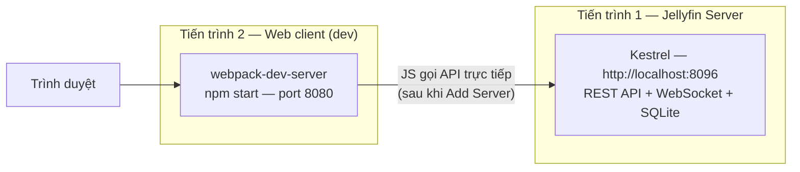

# Triển khai Jellyfin — môi trường phát triển Local (Windows)

> **Mục đích**: tài liệu hướng dẫn từ máy sạch (clean machine) cách dựng và chạy Jellyfin (server + web client) trên máy cá nhân để phục vụ đọc code / kiểm thử. Bám sát các bước nhóm đã thực hiện thực tế, kèm giải thích và ghi chú kỹ thuật.
>
> **Kết quả đầu ra**: Jellyfin Server chạy trên `http://localhost:8096`, giao diện web truy cập được và kết nối tới server, có thể đăng nhập và chạy các luồng nghiệp vụ cơ bản.
>
> **Liên quan**: cấu trúc project & kiến trúc xem `jellyfin-tong-quan.md`.

---

## 1. Kiến trúc triển khai (dev)

Môi trường phát triển gồm **2 tiến trình độc lập**:



- **Tiến trình 1** — Jellyfin Server (backend): build từ repo `ref/jellyfin`, chạy bằng VS Code (F5). Phục vụ REST API, WebSocket, quản lý DB/thư viện.
- **Tiến trình 2** — Jellyfin Web (frontend): repo riêng `ref/jellyfin-web`, chạy `npm start` (webpack-dev-server). Đây là giao diện người dùng.
- Trình duyệt mở web client ở port của dev server; web client được **trỏ tới địa chỉ server** (`http://localhost:8096`) trong bước "Add Server".
- Hai tiến trình nói chuyện qua HTTP/WebSocket trực tiếp với nhau, **không qua proxy**.

> Vì sao tách 2 tiến trình? Đây là cách Jellyfin khuyến nghị cho dev frontend: server chạy `--nowebclient` (không phục vụ file tĩnh web), còn web chạy bằng webpack-dev-server để có hot reload. Xem mục 11 để hiểu rõ điểm dễ nhầm `--nowebclient` vs `JELLYFIN_WEB_DIR`.

---

## 2. Yêu cầu môi trường (prerequisites)

| Phần mềm | Phiên bản | Ghi chú |
|---|---|---|
| Windows | 10/11 x64 | Môi trường đã thực hiện |
| .NET SDK | **10.0.x** | `global.json` yêu cầu `10.0.0`, rollForward `latestMinor`. **Bắt buộc.** |
| Git | bất kỳ | để clone và pin version |
| Node.js | **≥ 24** | `package.json` web yêu cầu `node >= 24` |
| npm | **≥ 11** | đi kèm Node 24 |
| FFmpeg | khuyến nghị (`jellyfin-ffmpeg`) | cần cho transcode/probe/thumbnail; không có vẫn khởi động server |
| VS Code + C# Dev Kit | mới | extension khuyến nghị: `ms-dotnettools.csharp`, `ms-dotnettools.csdevkit` |
| VS Code SQLite (tùy chọn) | `alexcvzz.vscode-sqlite` | xem `jellyfin.db` |

Kiểm tra nhanh:

```powershell
dotnet --version        # kỳ vọng: 10.0.x
dotnet --list-sdks      # phải có dòng 10.0.x
node --version          # kỳ vọng: v24.x (hoặc mới hơn)
npm --version           # kỳ vọng: 11.x (hoặc mới hơn)
git --version
ffmpeg -version         # nếu đã cài & có trong PATH
```

> Đường dẫn nhóm dùng: server `D:\KTPM\ref\jellyfin`, web `D:\KTPM\ref\jellyfin-web`. Có thể đặt nơi khác, nhưng **nhớ đổi đường dẫn trong `launchSettings.json`**.

---

## 3. Quy trình triển khai (7 bước)

### Bước 1 — Tải mã nguồn (server + web) và chốt phiên bản 12.2

Cả server lẫn web client đều dùng **release 12.2**. Lưu ý khác nhau về cách lấy mã nguồn:

```powershell
# Tạo thư mục chứa
New-Item -ItemType Directory -Force -Path "D:\KTPM\ref" | Out-Null

# (1) Server: clone repo gốc
git clone https://github.com/jellyfin/jellyfin.git D:\KTPM\ref\jellyfin

# (2) Web client: KHÔNG clone — tải bản release 12.2 của jellyfin-web rồi giải nén
#     https://github.com/jellyfin/jellyfin-web/releases/tag/v12.2
#     → đặt vào D:\KTPM\ref\jellyfin-web
```

**Chốt (pin) phiên bản — bắt buộc** để tránh master đổi giữa kỳ làm vỡ bài:

```powershell
# Server: clone rồi checkout đúng tag release 12.2 (repo có sẵn tag v12.2)
git -C D:\KTPM\ref\jellyfin checkout v12.2

# Kiểm tra phiên bản code thực tế của CẢ HAI (KHÔNG dựa vào git describe)
Get-Content   D:\KTPM\ref\jellyfin\SharedVersion.cs                       # kỳ vọng: 12.2.0
Select-String D:\KTPM\ref\jellyfin-web\package.json -Pattern '"version"'  # kỳ vọng: 12.2.0
```

> ⚠️ **Trạng thái thực tế trên máy nhóm (quan trọng)**: cả **server** và **web** đều được đưa về **12.2** bằng cách **tải bản release 12.2 rồi chép đè toàn bộ file vào thư mục tương ứng, giữ nguyên thư mục `.git` cũ** (server ban đầu clone từ master nên trước đó báo `13.0.0`; web cũng đã clone nên `.git` còn lại). Hệ quả cần lưu ý:
> - `.git` của **cả hai** repo vẫn ở commit master cũ (server `a45d1415d4`, web `319dbfc7e8`) → `git describe` / `git log` / `git status` **báo sai phiên bản**; cây làm việc "dirty" (server ~44 file, web ~1191 file).
> - **KHÔNG** chạy `git checkout` / `git reset --hard` / `git clean` / `git pull` trong hai repo — sẽ ghi đè/xoá mất code 12.2 (thay đổi chưa commit).
> - Pin version để báo cáo: **tag `v12.2`** + `SharedVersion.cs = 12.2.0` (server) và `package.json.version = 12.2.0` (web). Đừng dùng `git describe` máy móc.
> - Muốn repo 12.2 "sạch" & verify được bằng git: **clone mới rồi `git checkout v12.2`** — thay vì chép đè lên `.git` cũ. Riêng web chỉ cần giải nén release (không cần git).

### Bước 2 — Gỡ `origin` (server) để tránh push nhầm lên repo gốc

```powershell
git -C D:\KTPM\ref\jellyfin remote remove origin

# Kiểm tra (kỳ vọng: không còn dòng nào)
git -C D:\KTPM\ref\jellyfin remote -v
```

> Web client lấy từ **release (không phải clone)** nên không có `origin` để gỡ. Nếu ở máy bạn web lại được clone từ git, gỡ luôn: `git -C D:\KTPM\ref\jellyfin-web remote remove origin`.

Nếu muốn lưu bài lên repo của nhóm, thêm remote riêng cho server:

```powershell
git -C D:\KTPM\ref\jellyfin remote add origin <URL-repo-cua-nhom>
```

### Bước 3 — Cài Node & build web client (tạo `dist`)

```powershell
# Cài dependencies
npm --prefix D:\KTPM\ref\jellyfin-web install

# Build production → xuất ra D:\KTPM\ref\jellyfin-web\dist
npm --prefix D:\KTPM\ref\jellyfin-web run build:production
```

Kết quả: thư mục `D:\KTPM\ref\jellyfin-web\dist` chứa `index.html`, bundle JS/CSS, themes, assets.

> - Node/npm phiên bản đúng nằm ở `jellyfin-web\.nvmrc` (giá trị `24`).
> - Lệnh thay thế: `build:development` (có sourcemap, build nhanh) hoặc `build:check` (chỉ `tsc --noEmit`).
> - `dist` **bị gitignore**, không bao giờ commit.

### Bước 4 — Cấu hình server trong `launchSettings.json`

File: `D:\KTPM\ref\jellyfin\Jellyfin.Server\Properties\launchSettings.json`

Nhóm đã cấu hình:
1. Thêm khối `environmentVariables` ở cấp gốc, khai báo `JELLYFIN_WEB_DIR` trỏ tới thư mục `dist`.
2. Thêm `"commandLineArgs": "--nowebclient"` cho profile `"Jellyfin.Server"`.

Nội dung file hiện tại (đã cấu hình):

```json
{
  "profiles": {
    "Jellyfin.Server": {
      "commandName": "Project",
      "launchBrowser": true,
      "applicationUrl": "http://localhost:8096",
      "environmentVariables": {
        "ASPNETCORE_ENVIRONMENT": "Development"
      },
      "commandLineArgs": "--nowebclient"
    },
    "Jellyfin.Server (nowebclient)": {
      "commandName": "Project",
      "environmentVariables": {
        "ASPNETCORE_ENVIRONMENT": "Development"
      },
      "commandLineArgs": "--nowebclient"
    },
    "Jellyfin.Server (API Docs)": {
      "commandName": "Project",
      "launchBrowser": true,
      "launchUrl": "api-docs/swagger",
      "applicationUrl": "http://localhost:8096",
      "environmentVariables": {
        "ASPNETCORE_ENVIRONMENT": "Development"
      },
      "commandLineArgs": "--nowebclient"
    }
  },
  "environmentVariables": {
    "ASPNETCORE_ENVIRONMENT": "Development",
    "JELLYFIN_WEB_DIR": "D:/KTPM/ref/jellyfin-web/dist"
  }
}
```

Giải thích:

| Thiết lập | Ý nghĩa |
|---|---|
| `"commandLineArgs": "--nowebclient"` | Server **không** phục vụ web client tĩnh; chỉ chạy backend/API. Dùng khi web host riêng (Bước 6). |
| `"JELLYFIN_WEB_DIR": ".../dist"` | Đường dẫn thư mục web client. Chỉ có hiệu lực **khi server host web** (tức là **không** `--nowebclient`). |
| `"applicationUrl": "http://localhost:8096"` | Cổng mặc định của server. |
| `"ASPNETCORE_ENVIRONMENT": "Development"` | Bật Developer Exception Page, log chi tiết. |

> ⚠️ **Điểm dễ nhầm**: vì đang đặt `--nowebclient`, **`JELLYFIN_WEB_DIR` không được dùng cho việc phục vụ web**; web client lúc này do webpack-dev-server (Bước 6) cung cấp. Việc khai báo `JELLYFIN_WEB_DIR` là để sẵn nếu sau này bỏ `--nowebclient`. Chi tiết ở mục 11.

### Bước 5 — Chạy server bằng VS Code

1. Mở thư mục `D:\KTPM\ref\jellyfin` bằng VS Code (**File → Open Folder**).
2. Cài extension khuyến nghị (VS Code sẽ gợi ý: C# Dev Kit, C#).
3. Vào **Run and Debug**, chọn profile **`.NET Launch (console)`** (hoặc `Jellyfin.Server`), nhấn **F5**.

Hoặc chạy bằng CLI:

```powershell
dotnet run --project D:\KTPM\ref\jellyfin\Jellyfin.Server -- --nowebclient
```

Log khởi động mong đợi:

```
Jellyfin version: 12.2.0.0
...
Program data path: C:\Users\<user>\AppData\Local\jellyfin
Config directory path: C:\Users\<user>\AppData\Local\jellyfin\config
Cache path: C:\Users\<user>\AppData\Local\jellyfin\cache
...
Now listening on: http://0.0.0.0:8096
Startup complete
```

Kiểm tra server sống:

```powershell
# Khi --nowebclient: / thường redirect sang api-docs
Invoke-WebRequest http://localhost:8096/System/Info/Public -UseBasicParsing | Select-Object -ExpandProperty Content
# hoặc mở http://localhost:8096/api-docs/swagger/index.html
```

### Bước 6 — Chạy web client (dev) bằng `npm start`

Mở terminal **thứ hai**:

```powershell
npm --prefix D:\KTPM\ref\jellyfin-web start
```

→ webpack-dev-server chạy, mặc định ở `http://localhost:8080`. Mở địa chỉ này bằng trình duyệt.

> `npm start` = `npm run serve` = `webpack serve --config webpack.dev.js`. Config dev **không** chỉ định port → dùng mặc định **8080** của webpack-dev-server. Có hot reload khi sửa code trong `src/`.

### Bước 7 — Kết nối web client với server ("Add Server")

Trên giao diện web (`http://localhost:8080`):

1. Màn hình chọn/ thêm server hiện ra (do chưa cấu hình server).
2. Chọn **Add Server** / nhập địa chỉ server: `http://localhost:8096`.
3. Web client gọi `http://localhost:8096/System/Info/Public` để xác nhận — thành công sẽ hiện trang đăng nhập / setup.
4. **Lần chạy đầu tiên (DB trống)**: server yêu cầu **tạo tài khoản admin** (setup wizard) nếu chưa có user.
5. Sau khi đăng nhập: thêm thư mục media (Library), chạy scan, rồi chạy các luồng nghiệp vụ.

> Vì server chạy `--nowebclient`, wizard/setup sẽ do web client (port 8080) thực hiện qua API của server. Nếu gặp trang login thay vì setup, thử refresh một lần rồi mở lại.

---

## 4. Kiểm chứng triển khai thành công (checklist)

| # | Hạng mục | Cách kiểm |
|---|---|---|
| 1 | Server khởi động, bind 8096 | Log `Now listening on: http://0.0.0.0:8096` |
| 2 | API công khai phản hồi | `GET http://localhost:8096/System/Info/Public` → JSON có `Version`, `ServerName` |
| 3 | Swagger hiển thị | Mở `http://localhost:8096/api-docs/swagger/index.html` |
| 4 | Web client chạy | Mở `http://localhost:8080` → thấy giao diện Jellyfin |
| 5 | Web kết nối server | Add Server `http://localhost:8096` thành công |
| 6 | Đăng nhập/Setup | Tạo admin, đăng nhập được |
| 7 | Luồng nghiệp vụ | Thêm thư viện media → Scan → xem item; thử phát 1 video |
| 8 | DB được tạo | Tồn tại `%LocalAppData%\jellyfin\jellyfin.db` |

Endpoint hữu ích để kiểm tra API:

```
GET  /System/Info/Public
GET  /System/Info                (cần auth)
GET  /Users/Me                   (cần auth token)
GET  /api-docs/swagger/index.html
```

---

## 5. Biến môi trường & đường dẫn tham chiếu

Server đọc biến môi trường có tiền tố `JELLYFIN_` (và `ASPNETCORE_`, `DOTNET_`):

| Biến | Tác dụng | Mặc định (Windows) |
|---|---|---|
| `JELLYFIN_DATA_DIR` | Thư mục data gốc | `%LocalAppData%\jellyfin` |
| `JELLYFIN_CONFIG_DIR` | Thư mục config | `<data>\config` |
| `JELLYFIN_CACHE_DIR` | Thư mục cache | `<data>\cache` |
| `JELLYFIN_LOG_DIR` | Thư mục log | `<data>\log` |
| `JELLYFIN_WEB_DIR` | Thư mục web client tĩnh | `<thư mục app>\jellyfin-web` |
| `ASPNETCORE_ENVIRONMENT` | Môi trường ASP.NET (`Development`) | - |
| `JELLYFIN_NOWEBCONTENT=true` | Tương đương `--nowebclient` | - |

CLI tương ứng: `-d/--datadir`, `-c/--configdir`, `-C/--cachedir`, `-l/--logdir`, `-w/--webdir`, `--nowebclient`, `--ffmpeg <path>`.

Kiểm tra nhanh DB & config sau khi chạy:

```powershell
Get-ChildItem "$env:LocalAppData\jellyfin" -Force
# Kỳ vọng có: config\ (system.xml, encoding.xml, network.xml), cache\, log\, metadata\, jellyfin.db (+ -wal, -shm)
```

---

## 6. Xử lý sự cố thường gặp (troubleshooting)

| Triệu chứng | Nguyên nhân thường gặp | Cách xử lý |
|---|---|---|
| Build lỗi hàng loạt về C# version/`net10.0` | Sai/thiếu .NET 10 SDK | Cài đúng .NET 10 SDK, kiểm tra `dotnet --list-sdks` |
| Build fail vì analyzer/warning | `TreatWarningsAsErrors=true` + analyzer bật ở Debug | Sửa warning, hoặc build Release (`dotnet build -c Release`) |
| `Kestrel failed to start ... invalid address or port bind` | Cổng 8096 bị chiếm / bind sai trong `network.xml` | Đổi port trong `network.xml` hoặc tắt tiến trình đang giữ cổng (`netstat -ano | findstr 8096`) |
| Server báo `web content directory ... invalid or empty` | Đặt host web nhưng `WebPath` sai/rỗng | Chạy `--nowebclient` (đang dùng) hoặc trỏ `JELLYFIN_WEB_DIR` đúng vào `dist` |
| Web (8080) không kết nối được server | Sai địa chỉ / server chưa chạy / CORS | Kiểm tra server sống ở 8096; nhập đúng `http://localhost:8096` |
| Trang login không thành setup wizard | Web host tách server, cần refresh | Refresh trang login một lần (README cảnh báo) |
| `npm install`/`npm start` lỗi | Sai phiên bản Node/npm | Dùng Node ≥ 24, npm ≥ 11 (theo `.nvmrc`) |
| Không phát được video / không có thumbnail | Thiếu FFmpeg | Cài FFmpeg vào PATH, hoặc chạy với `--ffmpeg <path>` |
| DB hỏng / lần chạy trước lỗi | `jellyfin.db` + WAL lệch | Dừng server, xoá/backup `jellyfin.db*` rồi chạy lại (mất dữ liệu) |

---

## 7. Ghi chú kỹ thuật: `--nowebclient` và `JELLYFIN_WEB_DIR`

Đây là điểm dễ gây nhầm, ảnh hưởng trực tiếp tới cách triển khai:

- **Mode A — Server tự host web** (không dùng `--nowebclient`):
  - Server đọc file tĩnh từ `JELLYFIN_WEB_DIR` và phục vụ giao diện web ngay tại `http://localhost:8096`.
  - Không cần `npm start`; không cần port 8080.
  - Muốn dùng mode này: **bỏ** `--nowebclient`, giữ `JELLYFIN_WEB_DIR` trỏ vào `dist`, rồi restart server.

- **Mode B — Web host tách riêng** (nhóm đang dùng, có `--nowebclient`):
  - Server **không** phục vụ web tĩnh → `JELLYFIN_WEB_DIR` **không có tác dụng** cho việc host web.
  - Web client chạy bằng webpack-dev-server (`npm start`, port 8080), rồi "Add Server" trỏ về `http://localhost:8096`.
  - Ưu điểm: hot reload khi phát triển UI; phù hợp dev frontend.

> Trong cấu hình hiện tại nhóm vừa đặt `--nowebclient` **vừa** đặt `JELLYFIN_WEB_DIR` — điều này **không sai**, chỉ là `JELLYFIN_WEB_DIR` đang "để dành" cho Mode A. Nếu mục tiêu chỉ là chạy web ở 8080 thì có thể bỏ `JELLYFIN_WEB_DIR`; nếu muốn tiện chuyển nhanh sang Mode A thì giữ nguyên và chỉ cần bỏ `--nowebclient`.

---

## 8. Tóm tắt nhanh (TL;DR)

```powershell
# 0) Yêu cầu: .NET 10 SDK, Node >= 24, npm >= 11, (FFmpeg)

# 1) Server: clone + pin release 12.2
git clone https://github.com/jellyfin/jellyfin.git D:\KTPM\ref\jellyfin
git -C D:\KTPM\ref\jellyfin checkout v12.2
git -C D:\KTPM\ref\jellyfin remote remove origin
# 1b) Web: tải release 12.2 của jellyfin-web (KHÔNG clone) → giải nén vào D:\KTPM\ref\jellyfin-web
#     https://github.com/jellyfin/jellyfin-web/releases/tag/v12.2
# Pin: server SharedVersion.cs = 12.2.0; web package.json version = 12.2.0 (KHÔNG dựa vào git describe)

# 3) Build web
npm --prefix D:\KTPM\ref\jellyfin-web install
npm --prefix D:\KTPM\ref\jellyfin-web run build:production   # -> jellyfin-web\dist

# 4) Sửa Jellyfin.Server\Properties\launchSettings.json:
#    - "Jellyfin.Server": commandLineArgs = "--nowebclient"
#    - root environmentVariables: JELLYFIN_WEB_DIR = "D:/KTPM/ref/jellyfin-web/dist"

# 5) Chạy server (VS Code F5 -> .NET Launch (console)) hoặc:
dotnet run --project D:\KTPM\ref\jellyfin\Jellyfin.Server -- --nowebclient

# 6) Chạy web (terminal khác)
npm --prefix D:\KTPM\ref\jellyfin-web start     # http://localhost:8080

# 7) Trên web: Add Server -> http://localhost:8096 -> đăng nhập/setup
```
