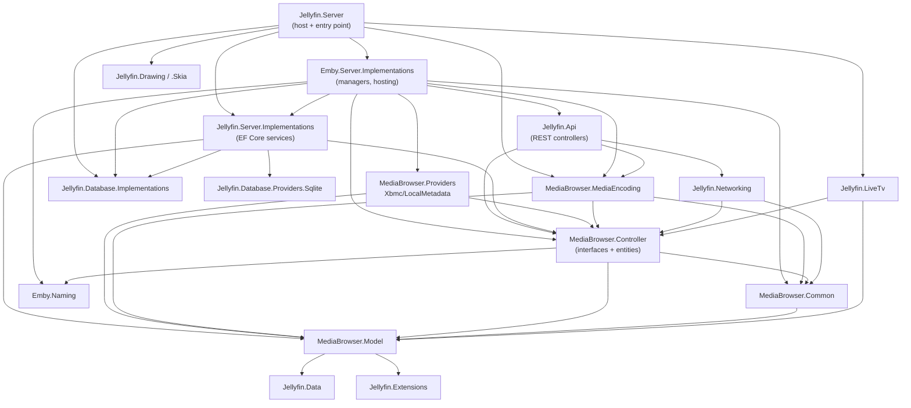
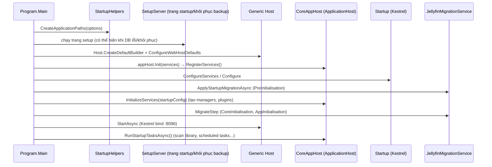
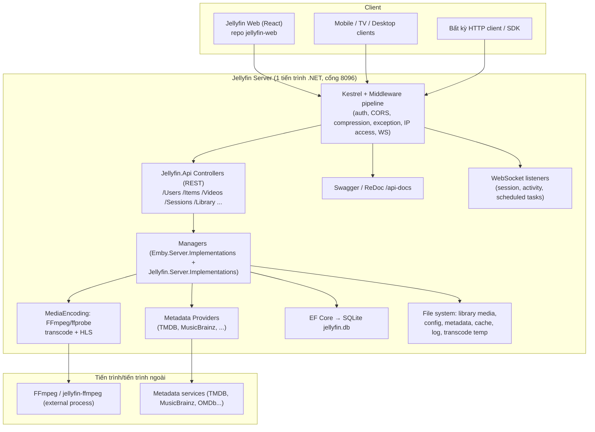
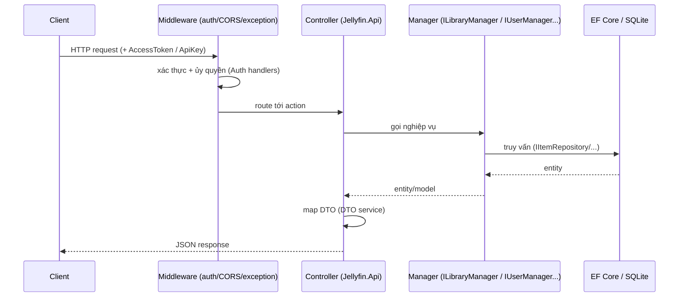
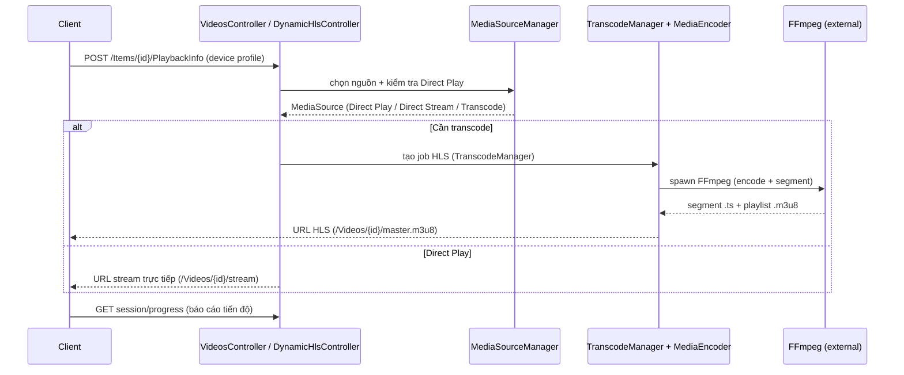
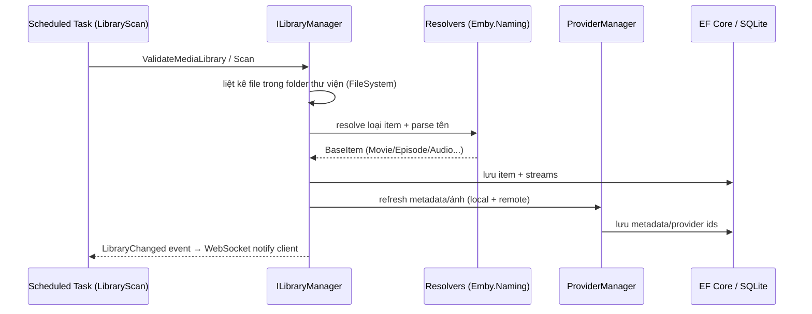

# Jellyfin (Server) — Tổng quan dự án cho Agent / On-boarding

> **Mục đích của tài liệu này**: giúp agent (và thành viên mới) hiểu ngay Jellyfin là gì, cấu trúc mã nguồn ra sao, kiến trúc và luồng dữ liệu như thế nào — để **không phải đi discover lại toàn bộ project** mỗi lần làm việc. Tài liệu này là bản đồ định vị (map), không thay thế việc đọc code khi cần chi tiết.
>
> **Đối tượng**: agent AI, kỹ sư QA on-boarding, thành viên nhóm đọc codebase.
>
> **Khi đọc code lần đầu, hãy đối chiếu với các bảng trong phần 4, 14, 15** — đó là các điểm mấu chốt.

---

## 1. Thông tin phiên bản & nguồn (quan trọng để "pin" phiên bản)

| Mục | Giá trị |
|---|---|
| Repo gốc | `https://github.com/jellyfin/jellyfin` (R14 trong danh sách đề tài) |
| Thư mục local (server) | `D:\KTPM\ref\jellyfin` |
| Thư mục local (web client) | `D:\KTPM\ref\jellyfin-web` |
| **Phiên bản code server (thực tế)** | **Release `v12.2`** — `SharedVersion.cs` = `12.2.0`, `VersionPrefix` các project = `12.2.0` |
| Nhánh / commit trong `.git` (server) | `master` @ `a45d1415d4`, `git describe` = `v12.0-rc7-250-ga45d1415d4` — **metadata git này CŨ hơn code** (xem gotcha §1) |
| Web client (pin/version) | repo `jellyfin-web` = **release `v12.2`**, `package.json` version = `12.2.0`; `.git` (nếu còn) vẫn ở `319dbfc7e8` (`v12.0-rc7-276`) — **metadata git CŨ hơn code** |
| Runtime | **.NET 10** (`net10.0`), có `global.json` yêu cầu SDK `10.0.0` |
| Thư viện chính | ASP.NET Core / EF Core `10.0.11`, Serilog.AspNetCore `10.0.0` |
| License | GPL-2.0 (server) / GPL-2.0-or-later (web) |
| Backend | ASP.NET Core + Kestrel |
| CSDL | **SQLite** (file `jellyfin.db`) qua **EF Core**, kiến trúc sẵn sàng cho provider khác (PostgreSQL experimental) |
| Web client | Repo riêng `jellyfin-web` (React + MUI + Webpack), build ra thư mục `dist` |

> ⚠️ **Lưu ý phiên bản & trạng thái git (gotcha quan trọng)**: Code server hiện là **bản release `v12.2` chính thức** — được tạo bằng cách tải bản release 12.2 rồi **chép đè toàn bộ file vào `D:\KTPM\ref\jellyfin`** (ban đầu repo được clone từ master nên trước đó báo `13.0.0`), **giữ nguyên thư mục `.git` cũ**. Hệ quả:
> - Thư mục `.git` vẫn trỏ tới commit master cũ (`a45d1415d4`, dòng `v12.0-rc7-250`) → các lệnh `git describe` / `git log` / `git rev-parse HEAD` / `git status` **báo sai phiên bản**, và cây làm việc đang **"dirty"** (~44 file khác biệt so với commit cũ).
> - **Pin phiên bản để báo cáo**: ghi **tag `v12.2` + `SharedVersion.cs = 12.2.0`** của code thực tế; **không** dùng `git describe`/`git rev-parse HEAD` máy móc (chúng cho giá trị CŨ). Repo `jellyfin-web` phải pin riêng vì là repo độc lập.
> - **TUYỆT ĐỐI KHÔNG** chạy `git checkout`, `git reset --hard`, `git clean`, `git stash` hay `git pull` trong repo server — sẽ **ghi đè/xoá mất** mã nguồn 12.2 và đưa về trạng thái 13.0-dev cũ (thay đổi chưa được commit).
> - Nếu cần một repo 12.2 "sạch" và verify được bằng git, nên **clone mới rồi checkout tag**: `git clone <repo> && git checkout v12.2` — thay vì chép đè file lên `.git` cũ.
> - Web client `jellyfin-web` **cũng đã được đưa về 12.2** theo cách tương tự (tải release 12.2 rồi chép đè, giữ `.git` cũ) → cùng có tình trạng git metadata cũ (`git describe` báo `v12.0-rc7-276`, cây "dirty" ~1191 file). Pin version web bằng `package.json.version = 12.2.0`.

---

## 2. Jellyfin là gì?

Jellyfin là **hệ thống media server mã nguồn mở** (đối thủ của Emby/Plex), cho phép:
- Quản lý thư viện media (phim, series, nhạc, sách, ảnh, live TV) trên server.
- Tổ chức metadata, ảnh bìa, phụ đề; quét và nhận diện tự động (providers).
- **Streaming** media tới nhiều client (web, mobile, TV) và **transcoding** (chuyển mã) theo thời gian thực khi client không đọc được định dạng gốc.
- Quản lý người dùng, phân quyền, phiên (session), thiết bị, đồng bộ phát (SyncPlay), ghi Live TV.

Jellyfin kế thừa từ Emby 3.5.2 và được port sang .NET. Vì lịch sử đó, nhiều namespace/project vẫn mang tiền tố **`Emby.`** và **`MediaBrowser.`** — **điều này là bình thường, không phải code lạ**.

- `Jellyfin.*` = code mới của Jellyfin.
- `Emby.*` / `MediaBrowser.*` = code kế thừa, vẫn là phần lõi (controller, entities, hosting).

---

## 3. Tech stack

| Lớp | Công nghệ chính |
|---|---|
| Ngôn ngữ | C# (`Nullable enable`, `TreatWarningsAsErrors=true`) |
| Web framework | ASP.NET Core, Kestrel, middleware pipeline |
| DI | `Microsoft.Extensions.DependencyInjection` (tự viết hệ thống "part/export" riêng trên nền DI) |
| ORM/DB | EF Core 10 + `Microsoft.Data.Sqlite` |
| Logging | **Serilog** (Console/File/Async/Graylog) + `logging.json` |
| API docs | Swashbuckle (Swagger UI + ReDoc) |
| Media xử lý | **FFmpeg** ngoài tiến trình (`jellyfin-ffmpeg`) qua `MediaBrowser.MediaEncoding`; SkiaSharp (ảnh), BDInfo (blu-ray) |
| Metrics | prometheus-net |
| CLI parsing | CommandLineParser |
| Config | XML (`system.xml`, `encoding.xml`, `network.xml`) + JSON (`logging.json`) |
| Web client | React 18, MUI 6, TanStack Query, Webpack 5, Vite (test) |
| Test | xUnit v3, AutoFixture, Moq, FsCheck (property-based) |

---

## 4. Cấu trúc Solution & trách nhiệm từng project

Solution: `Jellyfin.sln` (mở bằng VS Code / Visual Studio). Có ~30 project. Các project **server** chính:

| Project | Vai trò | Namespace tiêu biểu |
|---|---|---|
| **Jellyfin.Server** | **Composition root + entry point** (`Program.cs`, `Startup.cs`, `CoreAppHost.cs`). Assembly name xuất ra là `jellyfin` (chạy `jellyfin.exe`/`jellyfin.dll`). | `Jellyfin.Server` |
| **Emby.Server.Implementations** | **Trái tim nghiệp vụ**: `ApplicationHost` (abstract), hầu hết Manager cài đặt thật (`LibraryManager`, `UserManager`, `SessionManager`, `MediaSourceManager`, ...), hosting, entry points, scheduled tasks. | `Emby.Server.Implementations` |
| **Jellyfin.Server.Implementations** | Cài đặt mới đặt cạnh Emby: `UserManager` (EF Core), `ActivityManager`, `DeviceManager`, `TrickplayManager`, backup, media segments, security. | `Jellyfin.Server.Implementations` |
| **Jellyfin.Api** | **REST API layer**: ~60 Controllers, Auth handlers, middleware, model binders, DTO mapping, WebSocket listeners. | `Jellyfin.Api` |
| **MediaBrowser.Controller** | **Contracts (interfaces)**: `ILibraryManager`, `IUserManager`, `ISessionManager`, `ITranscodeManager`, `MediaBrowser.Controller.Entities` (BaseItem, Video, Audio, Series...). Đây là nơi **đọc để hiểu domain model**. | `MediaBrowser.Controller` |
| **MediaBrowser.Common** | Nền tảng dùng chung: `IServerApplicationHost`, config manager, plugin abstraction, networking helpers, cryptography, updates. | `MediaBrowser.Common` |
| **MediaBrowser.Model** | **DTO/POCO/model thuần**: cấu hình, entity data, request/response, enums, media info. Không phụ thuộc nội bộ (chỉ ASP.NET framework). | `MediaBrowser.Model` |
| **Jellyfin.Data** | Entity/query/event cho tầng dữ liệu mới. | `Jellyfin.Data` |
| **MediaBrowser.Providers** | **Metadata providers**: TMDB, MusicBrainz, OMDb, AudioDb, StudioImages, ListenBrainz... và `ProviderManager`/`MetadataService` (điều phối refresh metadata). | `MediaBrowser.Providers` |
| **MediaBrowser.MediaEncoding** | **Transcoding/probing/subtitles**: gọi FFmpeg, `Encoder`, `Transcoding` (HLS), `Probing` (ffprobe), `BdInfo`, subtitle extract/convert. | `MediaBrowser.MediaEncoding` |
| **MediaBrowser.XbmcMetadata** | Đọc/ghi metadata theo chuẩn Kodi/XBMC (`.nfo`). | `MediaBrowser.XbmcMetadata` |
| **MediaBrowser.LocalMetadata** | Đọc/ghi metadata local (`options.xml`, ảnh local, ...). | `MediaBrowser.LocalMetadata` |
| **Emby.Naming** | Parser tên file/thư mục media (nhận diện phim/series/nhạc từ tên). | `Emby.Naming` |
| **Emby.Photos** | Xử lý ảnh (photo resolver). | `Emby.Photos` |

Các project trong `src/` (cross-cutting / module hóa):

| Project (`src\...`) | Vai trò |
|---|---|
| **Jellyfin.Database.Jellyfin.Database.Implementations** | `JellyfinDbContext`, entities, cấu hình model, interfaces DB provider. |
| **Jellyfin.Database.Jellyfin.Database.Providers.Sqlite** | Provider SQLite + toàn bộ **EF Core migrations**. |
| **Jellyfin.Networking** | `NetworkManager`, quản lý interface/subnet/UPnP/HTTPS, Happy Eyeballs, AutoDiscovery. |
| **Jellyfin.LiveTv** | Live TV: tuner, guide, recordings, listing providers. |
| **Jellyfin.MediaEncoding.Hls** | Sinh playlist HLS, segment, keyframes. |
| **Jellyfin.MediaEncoding.Keyframes** | Trích xuất keyframe (seek nhanh). |
| **Jellyfin.Drawing** / **Jellyfin.Drawing.Skia** | Xử lý ảnh (Skia encoder, fallback `NullImageEncoder`). |
| **Jellyfin.Extensions** | Extension methods dùng chung. |
| **Jellyfin.CodeAnalysis** | Roslyn analyzer nội bộ (chỉ build Debug). |

Project test trong `tests/` (xUnit v3): `Jellyfin.Api.Tests`, `Jellyfin.Controller.Tests`, `Jellyfin.Naming.Tests`, `Jellyfin.MediaEncoding.Tests`, `Jellyfin.Networking.Tests`, `Jellyfin.Server.Tests`, `Jellyfin.Server.Integration.Tests`, `Jellyfin.Providers.Tests`, v.v.

Ngoài solution còn: `fuzz/` (AFL++ + SharpFuzz harness, README riêng) và repo `D:\KTPM\ref\oss-fuzz` (google/oss-fuzz — dùng cho kỹ thuật fuzzing K09, **không thuộc** jellyfin).

---

## 5. Đồ thị phụ thuộc giữa các project (dependency graph)

Nguyên tắc: **Model → Data → Common → Controller (interfaces) → Providers → Implementations → Api → Server (host)**. Không có vòng phụ thuộc ngược từ dưới lên trên.



---

## 6. Kiến trúc runtime (cách server thực sự khởi động)

### 6.1 Luồng khởi động (startup flow)



Điểm vào: `Jellyfin.Server/Program.cs:72` `Main` → `Parser.ParseArguments<StartupOptions>` → `StartApp`.
Sau đó: `Program.cs:168` `StartServer` dựng `CoreAppHost` và host ASP.NET Core. Kestrel pipeline nằm ở `Jellyfin.Server/Startup.cs`.

### 6.2 Hệ thống DI + "Parts"/Exports (điểm rất đặc trưng)

Jellyfin **không** đăng ký mọi thứ bằng tay. Nó dùng cơ chế:
- `ApplicationHost.RegisterServices(...)`: đăng ký các service nền tảng vào DI.
- `ApplicationHost.DiscoverTypes()` / `FindParts()`: quét toàn bộ assembly (lấy từ `GetAssembliesWithPartsInternal()`) để tìm các **implementation của interface** (`ILibraryManager`, `IMetadataProvider`, ...).
- `GetExportTypes<T>()` / `GetExports<T>()`: lấy ra tất cả implementation của một interface để chạy theo kiểu plugin/strategy.

Ví dụ: `CoreAppHost.GetAssembliesWithPartsInternal()` (`Jellyfin.Server/CoreAppHost.cs:115`) chỉ ra 4 assembly được quét part: `Jellyfin.Server` (CoreAppHost), `Jellyfin.Database.Implementations`, `Jellyfin.Server.Implementations`, `Jellyfin.LiveTv`.

**Hệ quả cho agent**: khi muốn "cắm" thêm một hành vi (thêm provider, thêm auth provider...), thường chỉ cần implement interface rồi để DI/part discovery tự tìm — nhưng phải hiểu `RegisterServices`/`GetExportTypes` trước khi sửa. Đừng giả định mọi thứ được đăng ký tường minh.

### 6.3 Plugin system

- Abstraction nằm ở `MediaBrowser.Common/Plugins` (`IPlugin`, `BasePlugin`, `BasePlugin<TConfigurationType>`, `PluginManager`, `IPluginManager`, `IHasPluginConfiguration`).
- Plugin thật nằm trong thư mục `plugins/` (đường dẫn `IServerApplicationPaths.PluginsPath`), load qua `PluginManager`, có file manifest (`PluginManifest`) và `IHasPluginConfiguration`.
- Một số "plugin" metadata (TMDB, OMDb, MusicBrainz, AudioDb, ...) **được build chung** trong `MediaBrowser.Providers/Plugins` (dạng embedded), tức không cần cài ngoài.

### 6.4 Mô hình "Manager"

Nghiệp vụ Jellyfin xoay quanh các **Manager singleton** cài đặt interface trong `MediaBrowser.Controller`. Các manager quan trọng:

| Manager | Interface | Trách nhiệm |
|---|---|---|
| `LibraryManager` | `ILibraryManager` | Quản lý item/thư viện, quét, resolve, query, xoá. **Trung tâm dữ liệu item.** |
| `ProviderManager` / `MetadataService` | `IProviderManager` | Refresh/đọc/ghi metadata, ảnh. |
| `UserManager` | `IUserManager` | Người dùng, quyền. Cài đặt (EF Core) ở `Jellyfin.Server.Implementations/Users`. |
| `SessionManager` | `ISessionManager` | Phiên kết nối client, playback session, remote control. |
| `MediaSourceManager` | `IMediaSourceManager` | Nguồn media, direct play/stream. |
| `TranscodeManager` | `ITranscodeManager` | Phiên transcode, job FFmpeg. |
| `MediaEncoder` | `IMediaEncoder` | Gọi FFmpeg/ffprobe. |
| `NetworkManager` | `INetworkManager` | Mạng, bind, published URL. |
| `LiveTvManager` | `ILiveTvManager` | Live TV. |
| `AuthenticationManager` / `AuthorizationContext` | `IAuthenticationManager` / `IAuthorizationContext` | Xác thực/ủy quyền request API. |
| `DtoService` | `IDtoService` | Map entity → DTO cho API. |
| `ImageProcessor` / `IImageEncoder` | `IImageProcessor` | Sinh/cache ảnh (SkiaSharp). |

---

## 7. Kiến trúc logic (C4 — mức container & component)



---

## 8. Các module/nghiệp vụ trọng tâm (3–5 module cốt lõi)

> Đây là các nghiệp vụ nên ưu tiên khi vẽ data flow / chọn phạm vi kiểm thử.

### 8.1 Thư viện & Metadata (Library & Metadata)
- **Item model**: `MediaBrowser.Controller/Entities` — `BaseItem` (gốc), `Folder`, `Video`, `Audio*`, `Series/Season/Episode`, `MusicAlbum`, `Movie`, `Book`, `Photo`, `Person`, `Studio`, `Genre`, `UserView`...
- **Quét**: `LibraryManager` + `MediaBrowser.Controller/Library` + resolvers (`IItemResolver`, `IResolverIgnoreRule`) + `Emby.Naming` để đoán loại media từ tên file.
- **Metadata**: `ProviderManager`, `MetadataService`, `I*MetadataProvider` (local, remote, embedded), savers (`IMetadataSaver`), `MediaBrowser.XbmcMetadata` (`.nfo`).
- **Persistence item**: `IItemRepository`, `IMediaStreamRepository`, `IChapterRepository` — phần lớn nội dung item nằm trong **`jellyfin.db`** (EF Core).

### 8.2 Streaming & Transcoding (Playback)
- Client hỏi thông tin phát → server trả `MediaSource`/`MediaStreams` (probe bằng FFmpeg).
- Nếu client không đọc được trực tiếp (Direct Play) → chọn Direct Stream hoặc **Transcode** (`ITranscodeManager`, `Encoder`, `Transcoding`).
- HLS: `Jellyfin.MediaEncoding.Hls` + `DynamicHlsController`, `HlsSegmentController`.
- File transcode tạm nằm ở thư mục transcode (cấu hình `encoding.xml`, `EncodingOptions.TranscodingTempPath`).

### 8.3 Xác thực / Phiên / Người dùng (Auth / Session / Users)
- **Auth**: `Jellyfin.Api/Auth` — nhiều handler/requirement: `CustomAuthenticationHandler` (custom scheme, không dùng cookie), `DefaultAuthorizationHandler`, `UserPermissionHandler`, `FirstTimeSetupHandler`, `LocalAccessOrRequiresElevationHandler`, `SyncPlayAccessHandler`, `AnonymousLanAccessHandler`.
- **Session**: `ISessionManager`, `SessionManager`, playback session, điều khiển remote, WebSocket push (`SessionWebSocketListener`...).
- **Users**: `UserManager`, `IDeviceManager`, `IDisplayPreferencesManager`, `IQuickConnect` (Quick Connect login).

### 8.4 Live TV
- Module riêng `Jellyfin.LiveTv` + `LiveTvController`: tuner hosts, guide (XMLTV/`Jellyfin.XmlTv`), recordings, `IRecordingsManager`, listing providers.

### 8.5 Networking & Database (nền tảng)
- `Jellyfin.Networking`: bind address, subnet, UPnP, HTTPS, published URL, auto-discovery (client dò ra server trong LAN).
- `Jellyfin.Database`: EF Core + SQLite, migrations tách theo provider (xem 10.2).

---

## 9. Luồng dữ liệu (data flow) của vài nghiệp vụ

### 9.1 Luồng 1 request API điển hình (đọc)



### 9.2 Luồng phát / transcode video



### 9.3 Luồng quét thư viện (library scan) — scheduled task



---

## 10. Lưu trữ dữ liệu & đường dẫn (paths)

### 10.1 Đường dẫn mặc định (theo `StartupHelpers.CreateApplicationPaths`)

Trên **Windows** (mặc định khi không truyền CLI/env):

| Loại | Đường dẫn mặc định | Override |
|---|---|---|
| Data (root) | `%LocalAppData%\jellyfin` | `-d/--datadir`, `JELLYFIN_DATA_DIR` |
| Config | `<data>\config` | `-c/--configdir`, `JELLYFIN_CONFIG_DIR` |
| Cache | `<data>\cache` | `-C/--cachedir`, `JELLYFIN_CACHE_DIR` |
| Log | `<data>\log` | `-l/--logdir`, `JELLYFIN_LOG_DIR` |
| Web resources | `<thư mục app>\jellyfin-web` | `-w/--webdir`, `JELLYFIN_WEB_DIR` |
| Metadata nội bộ | `<data>\metadata` | (suy ra) |
| CSDL | `<data>\jellyfin.db` | (suy ra) |
| Plugins | `<data>\plugins` | (suy ra) |

> Trên Linux/macOS dùng quy ước XDG cho data/cache. Các giá trị trên có thể xem trong log lúc khởi động (dòng `Program data path`, `Config directory path`, ...) — hữu ích để **verify môi trường chạy**.

### 10.2 File cấu hình & dữ liệu quan trọng

| File | Ý nghĩa |
|---|---|
| `<config>\system.xml` | Cấu hình hệ thống (ngôn ngữ, tính năng bật/tắt...). `IServerConfigurationManager.SystemConfigurationFilePath`. |
| `<config>\encoding.xml` | Cấu hình encode/transcode (bao gồm `TranscodingTempPath`). |
| `<config>\network.xml` | Cấu hình mạng (port, base URL, bind, HTTPS, remote access). |
| `<config>\migrations.xml` | Đánh dấu migration đã chạy. |
| `<config>\logging.json`, `logging.default.json` | Cấu hình Serilog. |
| `<data>\jellyfin.db` (+ `-wal`, `-shm`) | CSDL chính (SQLite/WAL). Lưu user, item, session, activity, devices, tokens... |
| `<data>\metadata\...` | Metadata/ảnh do server sinh nội bộ. |
| `<data>\plugins\...` | Plugin đã cài. |

**EF Core migrations** có 2 nhóm khác nhau — đừng nhầm:
- Migrations schema DB: `src/Jellyfin.Database/Jellyfin.Database.Providers.Sqlite/Migrations/` (chạy bằng `dotnet ef`).
- Migrations dữ liệu/logic khi nâng cấp phiên bản: `Jellyfin.Server/Migrations/` (`JellyfinMigrationService`, `Routines/`, `PreStartupRoutines/`, `Stages/`).

---

## 11. API layer (Jellyfin.Api)

- **Controllers**: `Jellyfin.Api/Controllers/*.cs` (~60 file): `ItemsController`, `VideosController`, `AudioController`, `LibraryStructureController`, `UserController`, `SessionController`, `DynamicHlsController`, `LiveTvController`, `SystemController`, `PackageController`, `PluginsController`, `BackupController`, `SearchController`, `TrickplayController`, ...
- **Đăng ký**: `Jellyfin.Server/Extensions/*` (`AddJellyfinApi`, `AddJellyfinApiSwagger`, `AddCustomAuthentication`, `AddJellyfinApiAuthorization`), được gọi trong `Startup.ConfigureServices`.
- **Pipeline** (`Startup.Configure`): `UseBaseUrlRedirection` → `UseForwardedHeaders` → `ExceptionMiddleware` → `ResponseTimeMiddleware` → `UseWebSockets` → `UseResponseCompression` → `UseCors` → `UseRequestLocalization` → (HTTPS) → (static web client nếu host) → `UseStaticFiles` → `UseAuthentication` → Swagger → `UseRouting` → `UseAuthorization` → `UseIPBasedAccessValidation` → `UseWebSocketHandler` → endpoints (`MapControllers`, `/health`, metrics).
- **Docs runtime**: Swagger UI `/api-docs/swagger/index.html`, ReDoc `/api-docs/redoc` (mặc định redirect tới swagger khi `--nowebclient`).
- **Auth**: scheme custom qua `CustomAuthenticationHandler`; token/API key được kiểm tra bởi `AuthorizationContext` (DB). Các policy: `DefaultAuthorization`, `UserPermission`, `FirstTimeSetup`, `LocalAccessOrRequiresElevation`, `SyncPlayAccess`, `AnonymousLanAccess`.
- **WebSocket**: `Jellyfin.Api/WebSocketListeners` + `WebSocketHandlerMiddleware` để đẩy sự kiện (session, activity log, scheduled tasks) theo thời gian thực.
- Health/metrics: `/health` (health checks), `/metrics` (Prometheus, nếu `EnableMetrics`).

---

## 12. Web client (repo riêng `jellyfin-web`)

- **Không nằm trong repo server** — là git repo độc lập (`D:\KTPM\ref\jellyfin-web`), React 18 + MUI 6 + TanStack Query + Webpack 5.
- Build production: `npm run build:production` → xuất ra `dist/`.
- Dev server: `npm start` (webpack-dev-server, mặc định **port 8080**).
- Server có thể **tự host** web client nếu `HostWebClient=true` (đọc file tĩnh từ `WebPath`), hoặc **không host** khi chạy `--nowebclient`.
- Client tự lưu địa chỉ server (qua `src/apps/.../session/addServer`) — dùng khi web host tách khỏi server.
- `package.json` đặt version `12.2.0` (khớp server 12.2); có `@jellyfin/sdk` và `@jellyfin/ux-web`.

Chi tiết cách build/run trong môi trường dev xem `trien-khai-moi-truong.md`.

---

## 13. Build, run & test

**Yêu cầu**: .NET 10 SDK, FFmpeg (`jellyfin-ffmpeg`/FFmpeg trong PATH), (và Node ≥ 24 / npm ≥ 11 nếu build web).

```powershell
# Build server
dotnet build D:\KTPM\ref\jellyfin\Jellyfin.Server\Jellyfin.Server.csproj

# Chạy server trực tiếp (host web nếu có WebPath)
dotnet run --project D:\KTPM\ref\jellyfin\Jellyfin.Server -- --webdir D:\KTPM\ref\jellyfin-web\dist

# Chạy KHÔNG host web client (web host tách riêng)
dotnet run --project D:\KTPM\ref\jellyfin\Jellyfin.Server -- --nowebclient

# Test
dotnet test D:\KTPM\ref\jellyfin\Jellyfin.sln
```

CLI options quan trọng (`Jellyfin.Server/StartupOptions.cs`): `-d/--datadir`, `-c/--configdir`, `-C/--cachedir`, `-l/--logdir`, `-w/--webdir`, `--nowebclient`, `--ffmpeg <path>`, `--service`, `--published-server-url`, `--mode`, `--restore-archive`.

VS Code: `.vscode/launch.json` có các config `.NET Launch (console)`, `.NET Launch (nowebclient)`, `.NET Attach`; `.vscode/tasks.json` có task `build`. Extension khuyến nghị: `ms-dotnettools.csharp`, `ms-dotnettools.csdevkit`, `alexcvzz.vscode-sqlite`.

---

## 14. Bản đồ định vị nhanh (Where to look for X)

| Cần tìm... | Đọc file/thư mục |
|---|---|
| Điểm khởi động server | `Jellyfin.Server/Program.cs`, `Jellyfin.Server/Startup.cs`, `Jellyfin.Server/CoreAppHost.cs` |
| Abstract host + service registration | `Emby.Server.Implementations/ApplicationHost.cs` |
| Interface domain (contracts) | `MediaBrowser.Controller/*.cs`, `MediaBrowser.Controller/Entities/` |
| Entity item (Movie/Series/Audio...) | `MediaBrowser.Controller/Entities/` |
| DTO model thuần | `MediaBrowser.Model/` |
| Controller REST | `Jellyfin.Api/Controllers/` |
| Pipeline middleware | `Jellyfin.Api/Middleware/`, `Jellyfin.Server/Startup.cs` |
| Auth / phân quyền | `Jellyfin.Api/Auth/` |
| WebSocket | `Jellyfin.Api/WebSocketListeners/`, `Jellyfin.Api/Middleware/WebSocketHandlerMiddleware.cs` |
| Library manager + scan | `Emby.Server.Implementations/Library/LibraryManager.cs` |
| Provider metadata | `MediaBrowser.Providers/` (+ `Manager/ProviderManager.cs`, `Manager/MetadataService.cs`) |
| Transcoding / FFmpeg | `MediaBrowser.MediaEncoding/Encoder`, `.../Transcoding`, `.../Probing` |
| HLS | `src/Jellyfin.MediaEncoding.Hls/` |
| Live TV | `src/Jellyfin.LiveTv/`, `Jellyfin.Api/Controllers/LiveTvController.cs` |
| Networking | `src/Jellyfin.Networking/` |
| DB context + entities | `src/Jellyfin.Database/Jellyfin.Database.Implementations/` |
| EF Core migrations | `src/Jellyfin.Database/Jellyfin.Database.Providers.Sqlite/Migrations/` |
| Data migrations khi nâng cấp | `Jellyfin.Server/Migrations/` |
| Users/Devices/Activity/Backup | `Jellyfin.Server.Implementations/` |
| Plugin system | `MediaBrowser.Common/Plugins/` |
| Parsing tên media | `Emby.Naming/` |
| Cấu hình mặc định (embedded) | `Jellyfin.Server/Resources/Configuration/` |
| Fuzz harness | `fuzz/` (+ repo `ref/oss-fuzz` — ngoài jellyfin) |

---

## 15. Lưu ý quan trọng cho agent (early-warning / gotchas)

1. **Đừng bỏ qua chữ `Emby.`/`MediaBrowser.`** — đó là code lõi, không phải rác. Đổi tên/refactor bừa rất dễ vỡ.
2. **Cơ chế "part/export" tự động**: nhiều service được DI/part discovery tìm thấy, không đăng ký tường minh. Trước khi thêm hành vi mới, đọc `ApplicationHost.RegisterServices`, `DiscoveryTypes`/`FindParts`, `GetExportTypes<T>`.
3. **`TreatWarningsAsErrors=true`** ở `Directory.Build.props` và analyzer bật `AllEnabledByDefault` ở Debug → build Debug **nghiêm ngặt**; code mới phải sạch analyzer (StyleCop, BannedApi...). Nhiều lỗi "build fail" là do analyzer, không phải logic.
4. **Web client là repo riêng** — thay đổi UI phải clone/build `jellyfin-web`, không có trong solution server.
5. **`--nowebclient` vs `--webdir`/`JELLYFIN_WEB_DIR`**: nếu `HostWebClient=false` (do `--nowebclient`) thì server **không** phục vụ web client bất kể `WebPath`/`JELLYFIN_WEB_DIR` đặt gì. WebPath chỉ có tác dụng khi server host web.
6. **`net10.0` + SDK preview**: cần đúng .NET 10 SDK (`global.json` roll-forward `latestMinor`). Thiếu/sai SDK → lỗi build hàng loạt.
7. **FFmpeg là tiến trình ngoài**: transcode/thumbnail cần FFmpeg có trong PATH (hoặc `--ffmpeg <path>`). Không có FFmpeg thì nhiều tính năng playback/metadata không chạy — nhưng server vẫn khởi động.
8. **SQLite WAL**: `jellyfin.db` đi kèm `-wal`/`-shm`; copy/backup thô có thể hỏng. Server có cơ chế retire WAL khi restore.
9. **Migration 2 tầng** (schema qua EF Core + data migration trong `Jellyfin.Server/Migrations`) — phân biệt rõ khi tìm nguyên nhân lỗi nâng cấp DB.
10. **Số cổng mặc định là 8096** (`applicationUrl` trong launchSettings, `DefaultHttpPort`); HTTPS mặc định 8920. Kiểm tra `network.xml` nếu bind lỗi.
11. **Setup wizard**: server lần đầu không có user sẽ yêu cầu setup. Nếu host web tách riêng (nowebclient) thì wizard có thể không chạy được (README cảnh báo) — phải tạo user qua client/khác.
12. **`fuzz/` + `ref/oss-fuzz`** liên quan kỹ thuật fuzzing (K09) — không phải một phần của runtime media server.
13. **Trạng thái git đặc biệt của repo server**: code đã được thay bằng release `v12.2` (chép đè file) nhưng `.git` vẫn ở master cũ (`a45d1415d4`) → `git` báo sai version và cây làm việc "dirty" (~44 file). **Không** chạy lệnh git mang tính ghi đè (`checkout`/`reset --hard`/`clean`/`pull`). Pin version bằng **tag `v12.2`**.
14. **Cả server lẫn web đều "dirty" và có git metadata cũ**: server = release `v12.2` (chép đè, `.git` cũ `a45d1415d4`); web = release `v12.2` (chép đè, `.git` cũ `319dbfc7e8`). Không chạy lệnh git ghi đè trên cả hai. Pin version bằng tag `v12.2` + `SharedVersion.cs`/`package.json` (đều `12.2.0`), không dùng `git describe`.

---

## 16. Thuật ngữ

| Thuật ngữ | Nghĩa |
|---|---|
| `BaseItem` | Lớp cơ sở cho mọi thực thể media (movie, episode, album, folder...). |
| `Provider` | Nguồn metadata (local file/embedded/remote service). |
| Direct Play / Direct Stream / Transcode | 3 chế độ phát: phát nguyên gốc / remux không encode lại / chuyển mã. |
| HLS | HTTP Live Streaming (playlist `.m3u8` + segment `.ts`) dùng khi transcode. |
| `Session` | Một client đang kết nối (thiết bị + user + playback state). |
| `Part/Export` | Cơ chế plugin nội bộ: quét assembly để tìm implementation interface. |
| `ServerApplicationPaths` | Đối tượng chứa mọi đường dẫn data/config/cache/log/web. |
| `DtoService` | Map entity → DTO trả về API. |
| Library scan | Tác vụ quét thư mục thư viện, resolve item, refresh metadata. |
