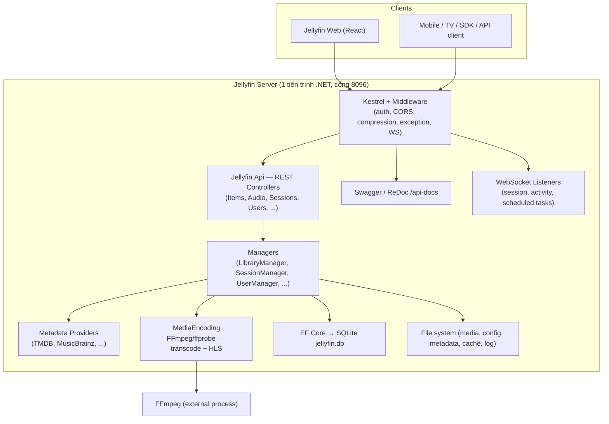

# Báo cáo tiến độ — Đợt 1 (bản nháp nội bộ)

> **Trạng thái**: **KHÔNG chính thức** — tài liệu nội bộ cho buổi báo cáo tiến độ ngày mai.
> Bản báo cáo **chính thức** sẽ theo cấu trúc A–H trong `ban_phan_cong_de_tai.md` và nộp trước mốc **20/10**. Tài liệu này **không** đi sâu vào kịch bản test/automation (sẽ chốt sau 20/10).
>
> **Đề tài**: R14 — `jellyfin/jellyfin` (media server backend) · **Kỹ thuật dự kiến**: K09 — **Fuzz Testing**
> **Phiên bản chốt (pin)**: release **`v12.2`** (xem `jellyfin-tong-quan.md` để biết chi tiết pin & gotcha về git)
> **Môi trường đã dựng**: chạy local thành công server + web (xem `trien-khai-moi-truong.md`)

---

## 1. Tổng quan sơ bộ Jellyfin

Jellyfin là **media server mã nguồn mở** (nhánh kế thừa từ Emby): quản lý thư viện media (phim/series/nhạc/sách/ảnh/Live TV), tự động lấy metadata, **streaming** và **transcoding** (qua FFmpeg) tới nhiều client, quản lý người dùng — phiên (session) — thiết bị.

**Tech stack chính**: C# / **.NET 10**, ASP.NET Core + Kestrel, **EF Core + SQLite** (`jellyfin.db`), Serilog, Swagger; xử lý media bằng **FFmpeg** ngoài tiến trình; web client là repo riêng `jellyfin-web` (React + MUI + Webpack).

### 1.1 Sơ đồ overview (mức container — sơ bộ)

### 1.2 Các project/module chính (rút gọn)

| Project | Vai trò |
|---|---|
| `Jellyfin.Server` | Composition root + entry point (`Program.cs`, `Startup.cs`, `CoreAppHost.cs`) |
| `Emby.Server.Implementations` | Lõi nghiệp vụ: `ApplicationHost`, các Manager (Library, Session, MediaSource, ...) |
| `Jellyfin.Server.Implementations` | Service mới: Users, Devices, Security/Auth, Activity, Backup, Trickplay |
| `Jellyfin.Api` | REST **~60 controllers**, auth handlers, middleware, WebSocket listeners |
| `MediaBrowser.Controller` | Contracts (interface) + entities (`BaseItem`, `Video`, `Audio`, `Series`...) |
| `MediaBrowser.Model` | DTO/POCO/model thuần |
| `MediaBrowser.Providers` | Metadata providers (TMDB, MusicBrainz, ...) |
| `MediaBrowser.MediaEncoding` | Transcoding/probing/subtitle (gọi FFmpeg) |
| `src/Jellyfin.*` | Cross-cutting: Networking, LiveTv, Database, MediaEncoding.Hls/Keyframes, Drawing, Extensions |

> Chi tiết đầy đủ (dependency graph, luồng dữ liệu, bảng "where to look for X") đã có trong `jellyfin-tong-quan.md`.

---

## 2. Tổng quan về Fuzz Testing (K09)

### 2.1 Định nghĩa & mục tiêu
**Fuzz testing** là kỹ thuật kiểm thử tự động **sinh ra lượng lớn input (thường là ngẫu nhiên/bất thường) với tốc độ rất cao** để đưa vào hệ thống, nhằm phát hiện các lỗi mà kiểm thử thông thường hay bỏ sót: **crash, treo (hang), tràn/đọc sai bộ nhớ, lỗi parser, lỗi xử lý file hỏng, treo vòng lặp, DoS nhỏ**. Không cần biết trước đáp án đúng (không cần oracle rõ ràng) — "oracle" chính là **hành vi bất thường của chương trình**.

### 2.2 Phân loại
- **Generation-based**: sinh input từ mô hình/định dạng (schema, grammar).
- **Mutation-based**: biến đổi (flip bit, chèn/xoá) từ **corpus** mẫu ban đầu.
- **Coverage-guided** (phổ biến nhất, ví dụ AFL++/libFuzzer): dùng **feedback về độ phủ** để ưu tiên input mở ra đường thực thi mới.
- **In-process vs Out-of-process**: chạy fuzz target trong/ngoài tiến trình; với .NET thường dùng out-of-process.

### 2.3 Thành phần của một "đề bài" fuzzing
| Thành phần | Ý nghĩa |
|---|---|
| **Fuzz target** | Hàm/đối tượng cụ thể nhận input thô (ví dụ một parser) |
| **Seed corpus** | Bộ input mẫu ban đầu để động cơ biến đổi |
| **Oracle** | Tiêu chí "lỗi": crash, hang timeout, assertion, sanitizer |
| **Mutation engine** | Động cơ sinh input (AFL++/libFuzzer) |
| **Coverage/reproducer** | Phủ mã + input nhỏ nhất tái hiện lỗi (minimized crash) |

### 2.4 Công cụ
- **AFL++**, **libFuzzer** (C/C++/Rust + sanitizers), **Jazzer** (JVM).
- Với .NET: **SharpFuzz** (cầu nối để chạy fuzz target .NET dưới AFL++/libFuzzer).

### 2.5 Giới hạn & tiêu chí áp dụng (theo đề bài)
- K09 **ưu tiên parser, xử lý file tải lên, chức năng Import/Export**.
- Cần **xây harness rõ ràng, tách biệt** — **tránh fuzz "mù mờ" toàn bộ hệ thống** (hệ thống quá lớn, không có fuzz target cụ thể thì vô nghĩa).
- Đầu ra mong đợi: **fuzz target + seed corpus + input tối thiểu tái hiện lỗi**.

### 2.6 Thuận lợi riêng của Jellyfin
Jellyfin **đã có sẵn hạ tầng fuzzing trong repo** (`fuzz/`): dùng **AFL++ + SharpFuzz**, gồm 2 project fuzz và seed corpus:

| Fuzz project | Fuzz target hiện có |
|---|---|
| `fuzz/Emby.Server.Implementations.Fuzz` | `PathExtensions.TryReplaceSubPath`, `SqliteItemRepository.ItemImageInfoFromValueString` |
| `fuzz/Jellyfin.Api.Fuzz` | `UrlDecodeQueryFeature` (middleware) |

→ Nhóm có thể **kế thừa harness sẵn có** và **mở rộng thêm fuzz target** cho các module mới, thay vì dựng từ đầu.

---

## 3. Phạm vi muốn test (sơ bộ)

> Đây là **phạm vi dự kiến** dựa trên một hành vi bất thường nhóm quan sát được khi sử dụng. Phạm vi chính thức (module/API nào sẽ fuzz, quy trình cụ thể) sẽ được chốt và trình bày trong báo cáo 20/10.

### 3.1 Kịch bản tự thử (manual test) đã quan sát
1. Đăng nhập web bằng tài khoản **A**.
2. Chọn thư viện **"Music"** → bật phát **1 bài nhạc**.
3. Mở **tab web mới**, đăng nhập **lại cùng tài khoản A** → bật một **bài nhạc khác**.
4. **Lặp lại vài lần** (nhiều tab cùng account A, mỗi tab một bài).
5. **Tạm dừng (pause) hoặc dừng (stop)** playback ở **một** tab bất kỳ.
6. → **Tất cả tab web đang đăng nhập bằng A đều bị lỗi.**

### 3.2 Hạn chế của lần thử hiện tại
- **Chưa** kiểm tra khi lỗi xảy ra thì **client khác** (thiết bị/trình duyệt khác, account khác) có bị ảnh hưởng hay không.
- Mới thử với **duy nhất thư viện "Music"** (nhạc), chưa thử video/phim.
- Chưa thu thập **log server** / **log console trình duyệt** tại thời điểm lỗi → chưa xác định chính xác mã lỗi (HTTP status / thông báo).

### 3.3 Các module/service liên quan tới vấn đề

**Nhóm 1 — Quản lý phiên & báo cáo playback (trung tâm vấn đề):**

| Module / Service | File | Liên quan vì |
|---|---|---|
| **SessionManager** | `Emby.Server.Implementations/Session/SessionManager.cs` | Xử lý `OnPlaybackStart/Progress/Stopped`; xoá `NowPlayingItem`; **session key = `Client + DeviceId + UserId`** (`GetSessionKey`); chỉ đóng session khi **không còn controller active** (`CloseIfNeededAsync`) |
| **SessionInfo** (model trạng thái) | `MediaBrowser.Controller/Session/SessionInfo.cs` | Chứa `PlayState`, `NowPlayingItem`, `NowPlayingQueue`, `PlaylistItemId`, `DeviceId`, `SessionControllers` — trạng thái dùng chung |
| **ISessionManager** (contract) | `MediaBrowser.Controller/Session/ISessionManager.cs` | Định nghĩa `OnPlaybackStart/Progress/Stopped`, `Sessions`, `GetSessions`, ... |
| **PlaystateController** | `Jellyfin.Api/Controllers/PlaystateController.cs` | Endpoint web gọi để báo cáo: `POST /Sessions/Playing`, `/Sessions/Playing/Progress`, `/Sessions/Playing/Stopped`, `/Sessions/Playing/Ping` |
| **RequestHelpers.GetSessionId** | `Jellyfin.Api/Helpers/RequestHelpers.cs` | Suy ra session từ **token + deviceId** của request → quyết định "tab nào thuộc session nào" |

**Nhóm 2 — Truyền thông thời gian thực (WebSocket):**

| Module / Service | File | Liên quan vì |
|---|---|---|
| **SessionInfoWebSocketListener** | `Jellyfin.Api/WebSocketListeners/SessionInfoWebSocketListener.cs` | Đăng ký `SessionStarted/Ended`, `PlaybackStart/Stopped/Progress` → **đẩy cập nhật session qua WebSocket** cho client |
| **SessionWebSocketListener** | `Emby.Server.Implementations/Session/SessionWebSocketListener.cs` | Xử lý kết nối WebSocket của session |
| **WebSocketController** | `Emby.Server.Implementations/Session/WebSocketController.cs` | `ISessionController`: một session có thể có **nhiều controller (nhiều tab)**, `IsSessionActive = HasOpenSockets` |

**Nhóm 3 — Phát nhạc & dữ liệu người dùng:**

| Module / Service | File | Liên quan vì |
|---|---|---|
| **AudioController / UniversalAudioController** | `Jellyfin.Api/Controllers/` | Endpoint phát nhạc (stream audio) |
| **MediaSourceManager** | `Emby.Server.Implementations/Library/MediaSourceManager.cs` | Chọn nguồn phát (direct play / transcode) cho bài nhạc |
| **UserDataManager** | `Emby.Server.Implementations/Library/UserDataManager.cs` | Cập nhật trạng thái đã phát / vị trí khi playback stop |
| **DeviceManager / AuthenticationManager** | `Jellyfin.Server.Implementations/Devices/`, `.../Security/` | Token & danh tính thiết bị — session gắn với `DeviceId` |

**Nhóm 4 — Phía web client (`ref/jellyfin-web`):**

| Module | File | Liên quan vì |
|---|---|---|
| **apphost — deviceId** | `ref/jellyfin-web/src/components/apphost.js` (`getDeviceId`, key `_deviceId2` lưu qua `appSettings`) | **deviceId được lưu bền và chia sẻ giữa các tab** cùng trình duyệt → mọi tab cùng account A trùng `(Client, DeviceId, UserId)` |
| **playbackmanager** | `ref/jellyfin-web/src/components/playback/playbackmanager.js` | Xử lý phát và báo cáo start/progress/stop |

### 3.4 Giả thuyết ban đầu (chưa kết luận)
Do `deviceId` được web lưu trong `appSettings`/`localStorage` nên **các tab của cùng một trình duyệt dùng chung một `DeviceId`**. Với session key `= Client + DeviceId + UserId`, **nhiều tab account A → cùng một session** trên server. Khi một tab báo `stop/pause` (`POST /Sessions/Playing/Stopped`), `SessionManager.OnPlaybackStopped` **xoá `NowPlayingItem`** của session dùng chung và phát sự kiện `PlaybackStopped` qua WebSocket → **mọi tab cùng session nhận cùng trạng thái** ⇒ có thể là nguyên nhân khiến tất cả tab cùng account A "lỗi".

> Đây mới là **giả thuyết**. Cần kiểm chứng bằng log server + log trình duyệt, và kiểm tra ảnh hưởng tới client khác.

### 3.5 Định hướng fuzz (sơ bộ — sẽ chốt sau 20/10)
- **Ưu tiên tận dụng harness sẵn có** trong `fuzz/` và **mở rộng fuzz target** cho các parser trong module liên quan, ví dụ:
  - `Emby.Naming/*` (parser tên file media: phim/series/nhạc).
  - `src/Jellyfin.LiveTv/TunerHosts/M3uParser.cs` (parser danh sách kênh `.m3u`).
  - `MediaBrowser.MediaEncoding/Subtitles/SubtitleEditParser.cs`, `SubtitleEncoder.cs` (parser phụ đề).
  - `MediaBrowser.LocalMetadata/Parsers/PlaylistXmlParser.cs` (parser playlist XML).
  - Các parser metadata XML/NFO (`MediaBrowser.XbmcMetadata/...`).
  - `Emby.Server.Implementations/Data/SqliteItemRepository` (parse chuỗi ảnh) và `Jellyfin.Api/Middleware/UrlDecodeQueryFeature` (đã có target).
- **Quy trình dự kiến**: chọn 1 fuzz target → viết/điều chỉnh harness (SharpFuzz) → seed corpus → chạy AFL++ → thu crash/hang → **minimize input tái hiện** → phân tích nguyên nhân (RCA).
- **Tiêu chí pass/fail & giả định** sẽ được trình bày trong báo cáo chính thức (Phần D/E).

---

## 4. Việc đã làm & kế hoạch tiếp theo

**Đã làm**
- Đọc hiểu cấu trúc & kiến trúc Jellyfin; viết tài liệu tổng quan (`jellyfin-tong-quan.md`).
- Dựng môi trường chạy local thành công (server + web); viết hướng dẫn triển khai (`trien-khai-moi-truong.md`).
- Chốt phiên bản repo = release **`v12.2`**.
- Nghiên cứu tổng quan kỹ thuật **Fuzz Testing** và hạ tầng fuzz có sẵn (`fuzz/`, SharpFuzz + AFL++).
- Ghi nhận một hành vi bất thường (manual test) và **khoanh vùng module/service liên quan**.

**Kế hoạch tiếp theo (tới 20/10)**
- Chốt **phạm vi chính thức** (module/API fuzz target), giả định, tiêu chí pass/fail.
- Thiết kế Test Model/Scenario và dựng harness fuzz trên module mục tiêu.
- Bổ sung bằng chứng ít nhất 3 luồng nghiệp vụ chạy được (phục vụ Milestone 2).

---

## 5. Tài liệu tham chiếu (nội bộ)
- `docs/jellyfin-tong-quan.md` — tổng quan kiến trúc/cấu trúc Jellyfin.
- `docs/trien-khai-moi-truong.md` — hướng dẫn dựng môi trường local.
- `docs/misc/ban_phan_cong_de_tai.md` — yêu cầu đề tài (cấu trúc A–H, mốc 20/10).
- `ref/jellyfin/fuzz/README.md` — hạ tầng fuzz có sẵn.
