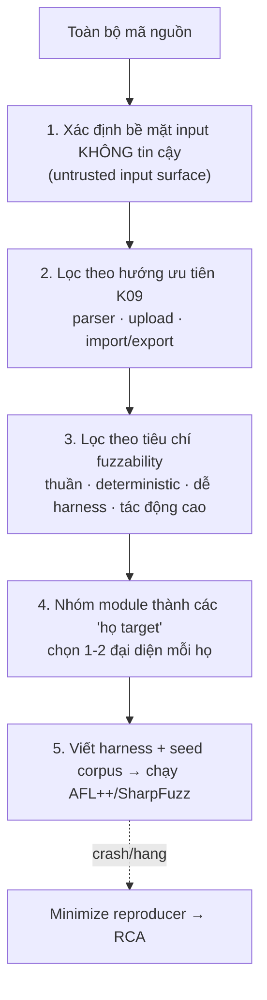
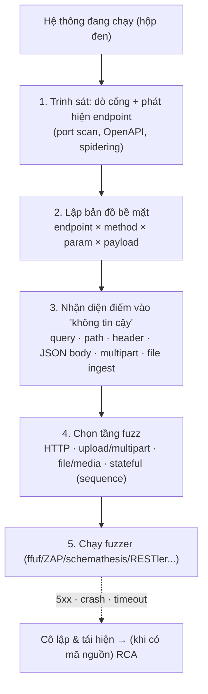

# Xác định đối tượng kiểm thử bằng Fuzzing (Fuzz Target Selection)

> **Mục đích**: Tài liệu **độc lập** (không thuộc báo cáo tiến độ). Trả lời câu hỏi: *"Nếu nhận dự án Jellyfin và được yêu cầu kiểm thử bằng **fuzzing**, thì sẽ chọn **target** nào, và chọn theo tiêu chí nào?"*
> Tài liệu trình bày **hai hướng**: **Hộp trắng** (khi **có** mã nguồn — §1–§6) và **Hộp đen** (khi **không** có mã nguồn — §7–§12).
>
> **Đối tượng**: thành viên nhóm cần chốt fuzz target; người đọc biết sơ bộ về Jellyfin.
> **Đề tài**: R14 — `jellyfin/jellyfin` · **Kỹ thuật**: K09 — Fuzz Testing.
> Bối cảnh kiến trúc tham khảo: `jellyfin-tong-quan.md`.

---

## 0. Nguyên tắc cốt lõi — chọn target **phụ thuộc vào việc có mã nguồn hay không**

Fuzzing **không** nên (và không thể) phủ toàn bộ một hệ thống lớn như Jellyfin. Ta cần **thu hẹp** về một (hoặc vài) **đối tượng cụ thể** — gọi là **fuzz target**. Nhưng **cách xác định** target khác nhau tuỳ ta có đọc được mã nguồn hay không:

| | **Hộp trắng** (White-box) | **Hộp đen** (Black-box) |
|---|---|---|
| **Tiền đề** | **Có** (đọc được) mã nguồn | **Không** có mã nguồn, chỉ có hệ thống **đang chạy** |
| **Đối tượng (target)** | **Hàm/parser cụ thể** (`Emby.Naming...`) | **Điểm giao tiếp** (HTTP endpoint, upload, protocol) |
| **Input** | Tham số hàm (`string`/`byte[]`/`Stream`) | Request/response, gói tin, byte "trên dây" |
| **Phương pháp chọn** | Đọc code → tìm hàm thuần, ít phụ thuộc | Trinh sát bề mặt → chọn endpoint/payload |
| **Harness** | Gọi hàm trực tiếp (SharpFuzz / AFL++) | Đẩy request vào cổng mạng / API |
| **Oracle** | Crash/exception của tiến trình test | HTTP 5xx, crash/restart server, timeout, DoS |
| **Công cụ** | SharpFuzz, AFL++, libFuzzer | ffuf, ZAP, schemathesis, RESTler, boofuzz |
| **Thuộc phần** | **§1–§6** | **§7–§12** |

> Hai hướng **bổ trợ nhau**, không loại trừ: **hộp đen** giúp tìm ra *bề mặt nào* dễ lỗi (theo hành vi quan sát được) mà **không cần mã nguồn**; **hộp trắng** chỉ ra *hàm nào* là gốc (RCA) và cho phép fuzz chính xác, có độ phủ (coverage) cao. Thực tế nên **bắt đầu bằng hộp đen** để khoanh vùng, rồi **chuyển sang hộp trắng** khi cần đi sâu.

### Quy trình chọn target — HỘP TRẮNG (khi có mã nguồn)

> **Quy trình hộp đen** (khi không có mã nguồn) xem §8.

---

## PHẦN I — HỘP TRẮNG (khi CÓ mã nguồn)

> Các mục §1–§6 dưới đây giả định **đã đọc được mã nguồn** Jellyfin và chọn target ở mức **hàm/parser**.

## 1. Bước 1 — Xác định bề mặt input không tin cậy

Jellyfin là *media server*, đầu vào **không tin cậy** đến từ nhiều nguồn. Nhóm lại theo "nguồn tấn công":

| Nguồn input không tin cậy | Ví dụ điển hình trong Jellyfin |
|---|---|
| **Tên file/đường dẫn media** | Tên file phim/series/nhạc/sách, cấu trúc thư mục, ổ đĩa mạng |
| **Nội dung file người dùng cung cấp** | Phụ đề (.srt/.vtt/.ass), playlist (.m3u/.pls), XML/NFO metadata, ảnh/SVG, file backup |
| **HTTP request** | Query string, header, body JSON, route parameter |
| **Dữ liệu từ dịch vụ ngoài** | JSON metadata (TMDB/OMDb), XMLTV EPG, Schedules Direct, HDHomeRun |
| **Giá trị lưu trong DB / config** | Chuỗi ảnh, JSON cấu hình, blob |

→ **Ghi nhận**: phần lớn bề mặt thuộc **parser file/chuỗi** và **import file** — trùng đúng ưu tiên K09.

---

## 2. Bước 2 — Lọc theo hướng ưu tiên K09

Đề bài K09 ưu tiên: **parser**, **xử lý file tải lên (upload)**, **Import/Export**. Áp lên Jellyfin:

| Hướng ưu tiên | Ánh xạ trong Jellyfin | Nhóm module tương ứng (xem §4) |
|---|---|---|
| **Parser** | Đọc/giải mã tên file, phụ đề, metadata XML, EPG, JSON | A, B, C, D, E, F, G |
| **Upload** | Tải lên phụ đề, ảnh, ảnh bìa, plugin package | B, H |
| **Import/Export** | Backup/Restore toàn hệ thống, nhập playlist/nhạc, export config | G, D, E |

→ Bước này loại bỏ các module **chỉ phục vụ giao tiếp/quản trị nội bộ** (session, logging, scheduled tasks) — trừ khi chúng *parse* dữ liệu không tin cậy.

---

## 3. Bước 3 — Tiêu chí "có fuzz được không" (fuzzability)

Không phải mọi parser đều đáng fuzz. Chấm điểm theo thang 1–5:

| Tiêu chí | Câu hỏi kiểm tra | Vì sao quan trọng |
|---|---|---|
| **Bề mặt (Attack surface)** | Input đến từ bên ngoài hay từ code nội bộ? | Input ngoài = kẻ tấn công kiểm soát được |
| **Tính thuần (Purity)** | Hàm có gần như thuần không? Có gọi mạng/FFmpeg/DB/file system không? | Có phụ thuộc ngoài ⇒ khó tái lập, dễ false-positive |
| **Xác định (Determinism)** | Cùng input ⇒ cùng hành vi? | Cần để "crash = bug thật" |
| **Dễ dựng harness** | Vào/ra là `string`/`byte[]`/`Stream`/`XDocument`? Có cần mock nặng? | Quyết định chi phí |
| **Tác động (Impact)** | Crash/hang → sập tiến trình server? DoS? | Ưu tiên lỗi nghiêm trọng |
| **Độ phức tạp logic** | Nhiều nhánh/regex/vòng lặp/đệ quy? | Càng phức tạp càng nhiều bug |

**Ưu tiên target** = các hàm: *thuần + nhận chuỗi/bytes + nhiều regex/nhánh + input từ ngoài*. **Tránh fuzz trực tiếp** các thành phần phụ thuộc tiến trình ngoài (FFmpeg, SQLite engine) và toàn bộ luồng HTTP đầy đủ (quá lớn) — thay vào đó fuzz **hàm con** (middleware/query/convert).

### Quan trọng: Jellyfin có sẵn "pattern" để gỡ phụ thuộc
Harness hiện có (`fuzz/Emby.Server.Implementations.Fuzz/Program.cs`) **mock `IServerApplicationHost` + `IConfiguration`** rồi mới gọi `SqliteItemRepository.ItemImageInfoFromValueString`. Đây chính là cách biến một hàm "dính DI" thành **fuzz target sạch** — có thể tái sử dụng cho nhiều target khác.

---

## 4. Bước 4 — Danh mục nhóm module ứng viên

Ký hiệu: **★** = ưu tiên cao (làm trước) · **◆** = đáng làm · **○** = tùy chọn/khó.

### Nhóm A — Parser tên file & đường dẫn media ★
`Emby.Naming/**` — regex-heavy, **thuần chuỗi → model**, không phụ thuộc mạng/DB. **Ứng viên số 1.**

| File | Entry point | Input |
|---|---|---|
| `Emby.Naming/Video/VideoResolver.cs` | `ResolveFile/ResolveDirectory/Resolve(...)`; `TryCleanString`; `CleanDateTime` | path/tên file |
| `Emby.Naming/Video/VideoListResolver.cs` | `Resolve(IReadOnlyList<VideoFileInfo>, ...)` | tập tên file |
| `Emby.Naming/Video/CleanStringParser.cs` | `TryClean(string?, IReadOnlyList<Regex>, out string)` | tên |
| `Emby.Naming/Video/StackResolver.cs` | `ResolveFiles/ResolveDirectories/Resolve(...)` | tập path |
| `Emby.Naming/Video/StubResolver.cs` | `TryResolveFile(path, options, out stubType)` | path |
| `Emby.Naming/Video/ExtraRuleResolver.cs`, `Format3D*`, `CleanDateTimeParser` | (rule-based) | tên |
| `Emby.Naming/TV/EpisodePathParser.cs` | `Parse(...)` | path |
| `Emby.Naming/TV/SeriesPathParser.cs` | `Parse(options, path)` | path |
| `Emby.Naming/TV/SeasonPathParser.cs` | `Parse(path, parentPath, ...)` | path |
| `Emby.Naming/AudioBook/AudioBookFilePathParser.cs` | `Parse(path)` | path |
| `Emby.Naming/Audio/AudioFileParser.cs` | `IsAudioFile(path, options)` | path |
| `Emby.Naming/Book/BookFileNameParser.cs` | `Parse(name)` | tên |
| `Emby.Naming/ExternalFiles/ExternalPathParser.cs` | `ParseFile(path, extraString)` | path |

### Nhóm B — Parser phụ đề (upload) ★
| File | Entry point | Input |
|---|---|---|
| `MediaBrowser.MediaEncoding/Subtitles/SubtitleEditParser.cs` | `Parse(Stream, string fileExtension)`, `SupportsFileExtension(string)` | **file phụ đề** (.srt/.vtt/.ass…) |
| `MediaBrowser.MediaEncoding/Subtitles/ISubtitleParser.cs` | interface của các parser | — |
| `MediaBrowser.MediaEncoding/Subtitles/SubtitleFormatExtensions.cs` | chuyển đổi định dạng | chuỗi |

> Lưu ý: một phần decode/convert phụ đề giao cho **FFmpeg** (ngoài tiến trình) ⇒ fuzz phần **parse trong repo** (`SubtitleEditParser`) thay vì gọi FFmpeg.

### Nhóm C — Parser metadata XML/NFO (import file) ★
| File | Entry point | Input |
|---|---|---|
| `MediaBrowser.XbmcMetadata/Parsers/{BaseNfoParser,MovieNfoParser,EpisodeNfoParser,SeriesNfoParser,SeasonNfoParser,SeriesNfoSeasonParser}.cs` | `Fetch(MetadataResult<T>, string metadataFile, CancellationToken)` | **file .nfo (XML)** |
| `MediaBrowser.LocalMetadata/Parsers/{BaseItemXmlParser,BoxSetXmlParser}.cs` | `Fetch(...)` | **file XML** |
| `MediaBrowser.Providers/Books/ComicInfo/ComicInfoReader.cs` | `ReadComicBookMetadata(XDocument)`, `ReadPeopleMetadata`, `ReadCultureInfoInto` | **XML** (đã tách sẵn `XDocument`) |

### Nhóm D — Parser playlist & danh sách phát ◆
| File | Entry point | Input |
|---|---|---|
| `MediaBrowser.LocalMetadata/Parsers/PlaylistXmlParser.cs` | `Fetch(...)` | file XML playlist |
| `MediaBrowser.Providers/Playlists/PlaylistItemsProvider.cs` | đọc playlist | file |
| `Emby.Server.Implementations/Playlists/PlaylistManager.cs` | tạo/đọc playlist | dữ liệu playlist |

### Nhóm E — EPG / Live TV (file & JSON ngoài) ◆
| File | Entry point | Input |
|---|---|---|
| `src/Jellyfin.LiveTv/TunerHosts/M3uParser.cs` | `Parse(TunerHostInfo, string, CancellationToken)`, `GetListingsStream(...)` | **file .m3u** |
| `src/Jellyfin.LiveTv/Listings/XmlTvListingsProvider.cs` | `GetProgramsAsync(...)`, `GetChannels(...)` | **file XMLTV (.xml)** |
| `src/Jellyfin.LiveTv/Listings/SchedulesDirect.cs` + `SchedulesDirectDtos/*` | deserialize JSON | **JSON remote** |
| `src/Jellyfin.LiveTv/TunerHosts/HdHomerun/*` (`DiscoverResponse`, `Channels`) | parse JSON thiết bị | **JSON** |

> `M3uParser` / `XmlTv` phụ thuộc `TunerHostInfo`/`ListingsProviderInfo` (cấu hình) — có thể mock, nhưng chi phí harness cao hơn nhóm A/B.

### Nhóm F — Bộ chuyển đổi JSON & (de)serialization ★
`src/Jellyfin.Extensions/Json/Converters/**` — mỗi converter là **một hàm parse chuỗi thuần**, rất dễ harness.

| File (`Jellyfin.Extensions/Json/Converters/`) | Đối tượng parse |
|---|---|
| `JsonVersionConverter.cs` | `Version` |
| `JsonGuidConverter.cs`, `JsonNullableGuidConverter.cs` | `Guid` |
| `JsonBoolStringConverter.cs`, `JsonBoolNumberConverter.cs` | `bool` |
| `JsonCommaDelimitedCollectionConverter.cs`, `JsonDelimitedCollectionConverter.cs`, `JsonPipeDelimitedCollectionConverter.cs` | tập giá trị phân tách |
| `JsonDefaultStringEnumConverter.cs`, `JsonFlagEnumConverter.cs` | enum |
| `JsonDateTimeConverter.cs`, `JsonStringConverter.cs`, `JsonNullableStructConverter.cs` | ngày giờ/struct |

Kèm: `Emby.Server.Implementations/Serialization/MyXmlSerializer.cs` — `DeserializeFromStream/File/Bytes` (**XML deserialization**, liên quan XXE).

### Nhóm G — Import / Export / Backup ★
| File | Entry point | Input |
|---|---|---|
| `Jellyfin.Server.Implementations/FullSystemBackup/BackupService.cs` | `RestoreBackupAsync(string)`, `GetBackupManifest(string)`, `EnumerateBackups()` | **file archive backup** |
| `MediaBrowser.Controller/SystemBackupService/{BackupManifestDto,BackupOptionsDto,BackupRestoreRequestDto}.cs` | model manifest | JSON trong archive |
| `Jellyfin.Api/Controllers/BackupController.cs` | endpoint upload/restore | HTTP |
| `Emby.Server.Implementations/Plugins/PluginManager.cs`, `Jellyfin.Api/Controllers/PluginsController.cs` | cài plugin từ file/zip/URL | **package zip**, JSON manifest |

### Nhóm H — Ảnh & SVG (upload) — bảo mật cao ◆
| File | Entry point | Input |
|---|---|---|
| `src/Jellyfin.Drawing.Skia/SvgSecurityValidator.cs` | `IsSafe(string path, out reason)`, `IsSafe(Stream, out reason)` | **SVG** — đây chính là "validator", fuzz rất trực tiếp |
| `src/Jellyfin.Drawing.Skia/SkiaEncoder.cs` | `GetImageSize`, `EncodeImage`, `GetImageBlurHash`, `CreateImageCollage`, `CreateTrickplayTile` | **file ảnh** |
| `src/Jellyfin.Drawing.Skia/StripCollageBuilder.cs`, `SplashscreenBuilder.cs` | dựng collage/splash | ảnh |

> Phụ thuộc native **SkiaSharp** ⇒ cần seed corpus ảnh hợp lệ; crash có thể đến từ native ⇒ cần lưu ý khi phân loại.

### Nhóm I — Crypto / định dạng token ○
| File | Entry point | Input |
|---|---|---|
| `MediaBrowser.Model/Cryptography/PasswordHash.cs` | `Parse(ReadOnlySpan<char>)` | **chuỗi hash PBKDF2** |
| `MediaBrowser.Model/ApiClient/*` (`ServerDiscoveryInfo`) | deserialize | JSON |

### Nhóm J — HTTP / middleware / query ★ (đã có target mẫu)
| File | Entry point | Input |
|---|---|---|
| `Jellyfin.Api/Middleware/UrlDecodeQueryFeature.cs` | (đã có target `UrlDecodeQueryFeature`) | **query string** |
| `Jellyfin.Api/Middleware/QueryStringDecodingMiddleware.cs` | xử lý query | query string |
| `Jellyfin.Api/Middleware/*` (BaseUrl, IpAccess, Robots…) | xử lý request | route/header |

### Nhóm K — Parse chuỗi từ DB ◆ (đã có target mẫu)
| File | Entry point | Input |
|---|---|---|
| `Emby.Server.Implementations/Data/SqliteItemRepository.cs` | `ItemImageInfoFromValueString(string)` | **chuỗi lưu trong DB** |
| `Emby.Server.Implementations/Library/PathExtensions.cs` | `TryReplaceSubPath(...)` | path |

---

## 5. Bước 5 — Shortlist đề xuất (làm trước)

| Ưu tiên | Target đề xuất | Nhóm | Lý do chọn đầu |
|---|---|---|---|
| **1** | `Emby.Naming` — `VideoResolver.ResolveFile`, `EpisodePathParser.Parse`, `SeasonPathParser.Parse`, `CleanStringParser.TryClean` | A | Thuần chuỗi→model, nhiều regex/nhánh, không phụ thuộc ngoài, harness cực dễ |
| **2** | `Jellyfin.Extensions/Json/Converters/*` (Guid/Version/bool/delimited/enum) | F | Mỗi converter là 1 hàm parse thuần, corpus dễ sinh |
| **3** | `XbmcMetadata` / `LocalMetadata` `.Fetch(...)`, `ComicInfoReader.ReadComicBookMetadata` | C | Import file XML/NFO; liên quan bảo mật (XXE/entity expansion) |
| **4** | `SubtitleEditParser.Parse(Stream, ext)` | B | Đúng ưu tiên K09 "file upload" |
| **5** | `BackupService.GetBackupManifest` / `RestoreBackupAsync` | G | Đúng ưu tiên K09 "Import/Export" |
| **6** | `SvgSecurityValidator.IsSafe(Stream, out reason)` | H | Chính là hàm "validate input" — fuzz để tìm bypass/DoS |
| 7 | `MyXmlSerializer.DeserializeFromBytes/Stream` | F | XML deserialization tập trung |

> Các target **đã tồn tại** trong repo (có thể chạy ngay để làm quen quy trình): `PathExtensions.TryReplaceSubPath`, `SqliteItemRepository.ItemImageInfoFromValueString` (`fuzz/Emby.Server.Implementations.Fuzz`) và `UrlDecodeQueryFeature` (`fuzz/Jellyfin.Api.Fuzz`).

### Không nên đặt target trực tiếp
| Thành phần | Lý do |
|---|---|
| **FFmpeg / ffprobe** | Tiến trình ngoài, C/C++ — ngoài phạm vi fuzz .NET; fuzz đầu vào của nó là bài toán khác |
| **Toàn bộ pipeline HTTP server** | Quá lớn, không có oracle rõ ràng ⇒ fuzz "mù mờ" vô nghĩa; thay bằng fuzz từng middleware/hàm parse request |
| **SQLite engine** | Thư viện ngoài; chỉ fuzz **chuỗi truyền vào** repo (nhóm K) |
| **Logic phiên (session/playback)** | Hàm trạng thái, phụ thuộc DI/nhiều bước ⇒ phù hợp test tích hợp hơn là fuzz |

---

## 6. Hạ tầng fuzz có sẵn của Jellyfin (cách thêm target)

Repo **đã có sẵn hạ tầng** — không cần dựng từ đầu:

- **Công cụ**: **AFL++ + SharpFuzz** (out-of-process). Cài: `AFLplusplus` + `dotnet tool install --global SharpFuzz.CommandLine`.
- **2 project fuzz** (mỗi project có `fuzz.sh` + thư mục `Testcases/<tên target>/` làm seed corpus):
  - `fuzz/Emby.Server.Implementations.Fuzz` (tham chiếu `Emby.Server.Implementations` + `MediaBrowser.Controller`).
  - `fuzz/Jellyfin.Api.Fuzz` (tham chiếu `Jellyfin.Api`).
- **Cơ chế**: `Program.Main(args[0])` — chọn hàm theo tên; thân hàm là fuzz target nhận `Action<string>`.

**Thêm target mới (quy trình ngắn)**:
1. Chọn hàm mục tiêu (theo §4).
2. Thêm `case "Tên.Target": Run(HàmTarget);` vào `Program.cs` của project fuzz phù hợp.
3. Viết hàm `HàmTarget(string data)` — ép `data` thành tham số của hàm đích (tách chuỗi, dựng `Stream`…). Nếu hàm dính DI → **mock** theo mẫu `MockSqliteItemRepository()` sẵn có.
4. Tạo `Testcases/Tên.Target/test1.txt` làm seed corpus ban đầu.
5. Chạy `./fuzz.sh "Tên.Target"` → quan sát `Findings/Tên.Target/`.

---

## PHẦN II — HỘP ĐEN (khi KHÔNG có mã nguồn)

> Dùng khi ta **chỉ có hệ thống đang chạy** (bản build / container / server đã dựng), **không đọc mã nguồn**. Đối tượng fuzz là **điểm giao tiếp (interface)** thay vì hàm.

## 7. Hộp đen khác hộp trắng ở đâu (về cách chọn target)

Ở hộp đen, ta **không biết tên hàm/class**, nên không thể "chọn parser X". Thay vào đó ta trả lời: *hệ thống **phơi ra những cổng vào nào**, và cổng nào **nhận dữ liệu có cấu trúc**?*

- **Target hộp đen** = một bộ **(giao thức, endpoint, tham số, loại payload)** — ví dụ `POST /Backup/Restore` với body `multipart/form-data` chứa archive.
- Không cần mã nguồn ⇒ dễ bắt đầu, nhưng **oracle yếu hơn**: chỉ quan sát được **biểu hiện bên ngoài** (5xx, crash, treo, phình RAM) — không có crash stack / sanitizer như hộp trắng.
- Vì không thấy đường đi nội bộ, **không đo được coverage**; phải dựa vào **OpenAPI/Swagger + log** để tăng độ phủ bề mặt.

## 8. Quy trình chọn target — HỘP ĐEN

| Bước | Việc làm | Công cụ gợi ý |
|---|---|---|
| 1. Trinh sát | Dò cổng; phát hiện endpoint; thu thập swagger/robots/thông báo lỗi | `nmap`, `curl`, `ffuf` (discovery), ZAP Spider |
| 2. Bản đồ bề mặt | Liệt kê endpoint × method × tham số × schema | **OpenAPI/Swagger** của Jellyfin, Postman/Insomnia |
| 3. Xác định điểm vào | Tìm tham số số học/độ dài/định dạng, body phức tạp, upload | đọc swagger + thử tay |
| 4. Chọn tầng fuzz | HTTP param/body · multipart upload · file ingest · sequence | `ffuf`, ZAP, **schemathesis**, **RESTler** |
| 5. Chạy & oracle | Phân tích mã lỗi / crash / timeout / RAM | log server, theo dõi container restart |

## 9. Bản đồ bề mặt (interface) của Jellyfin — nhìn từ ngoài

Điểm mạnh của hộp đen: **không cần mã nguồn vẫn liệt kê được bề mặt**. Jellyfin thậm chí **tự công bố** API qua Swagger/OpenAPI.

| Bề mặt | Địa chỉ / cách tiếp cận | Ghi chú |
|---|---|---|
| **Web client (SPA)** | `http://<host>:8096/` | Giao diện người dùng |
| **REST API** | `http://<host>:8096/<Controller>/...` | Xem nhóm bên dưới |
| **OpenAPI / Swagger** | `/api-docs/openapi.json` · `/api-docs/swagger/index.html` · `/api-docs/redoc` | **Bản đồ tự công bố** — chìa khoá của hộp đen |
| **WebSocket** | `ws://<host>:8096/socket` | Tin nhắn JSON (Inbound/Outbound) |
| **HTTPS** | cổng **8920** (nếu bật) | |
| **Khám phá mạng** | UDP **7359** (client discovery), UDP **1900** (SSDP) | Dịch vụ quảng bá |
| **Nạp file media** | Trỏ thư viện vào thư mục chứa file **do ta kiểm soát** | Kích hoạt parser tên file + probe media |
| **Upload file** | endpoint phụ đề / ảnh / backup / plugin | `multipart/form-data` |

**Nhóm endpoint REST đáng chú ý** (theo tên controller/route quan sát từ ngoài):

| Nhóm endpoint | Ví dụ route | Dữ liệu vào để fuzz |
|---|---|---|
| Xác thực | `/Auth/...` | JSON body, token |
| Người dùng | `/Users/...` | JSON, query |
| Items / Media | `/Items`, `/Users/{userId}/Items`, `/Videos/{itemId}/...` | query phức tạp, path id |
| Phát nhạc / video | `/Audio/{itemId}/...`, `/Videos/{itemId}/...` | query (`offset`, `ticks`), `Range` header |
| Phụ đề | `/Videos/{itemId}/Subtitles/...`, `/Items/{itemId}/RemoteSearch/Subtitles/{language}` | **upload phụ đề (multipart)** |
| Playlist | `/Playlists/...`, `/Playlists/{playlistId}/Items` | JSON body |
| Ảnh | `/Items/{itemId}/Images/...` | **upload ảnh / ảnh từ xa** |
| Sao lưu | `/Backup/Create`, `/Backup/Restore` | **archive upload** |
| Plugin / Gói | `/Plugins/...`, `/Packages/...` | package/zip + JSON |
| Thư viện | `/Library/...`, `/Library/VirtualFolders` | path cấu hình |
| Live TV | `/LiveTv/...` | `.m3u`/XMLTV, tuner URL |
| Tìm kiếm / Gợi ý | `/Search/Hints`, `/Artists`, `/Shows` | query dài / ký tự đặc biệt |

## 10. Tiêu chí & shortlist target hộp đen

**Tiêu chí chọn điểm vào** (song song với §3, nhưng áp cho endpoint):
- Nhận **payload có cấu trúc** (JSON/XML/multipart/archive) ⇒ dễ chạm parser.
- Có **tham số số học / độ dài / định dạng** (`ticks`, `offset`, `id`, `version`, số kênh…).
- **Xử lý file do người dùng cung cấp** (phụ đề, ảnh, backup, playlist, `.m3u`).
- **Xác thực yếu hoặc không cần** ⇒ bề mặt mở rộng (`/System`, `/Auth`, discovery).
- **Trạng thái nhiều bước** ⇒ ưu tiên **stateful fuzzing** (chuỗi request) hơn là random.

**Shortlist (làm trước)**:

| Ưu tiên | Bề mặt hộp đen | Tầng fuzz | Tương ứng hộp trắng |
|---|---|---|---|
| 1 | Toàn bộ REST API (query/path/body) | HTTP fuzzing (schemathesis/RESTler/ZAP) | F, J |
| 2 | Upload phụ đề (`/Videos/{id}/Subtitles`, RemoteSearch) | multipart + file fuzz | B |
| 3 | Upload / Sao lưu / Plugin (`/Backup`, `/Plugins`) | archive/zip fuzz | G |
| 4 | Upload ảnh (`/Items/{id}/Images`) | ảnh / SVG fuzz | H |
| 5 | Nạp file media vào thư viện | đặt file lỗi vào thư mục | A (+ FFmpeg) |
| 6 | WebSocket `/socket` | JSON message fuzz | (session/event) |
| 7 | Live TV (`/LiveTv`, tuner/EPG) | XMLTV / M3U / JSON | E |
| 8 | Discovery / SSDP (UDP) | protocol fuzz (boofuzz) | (mạng) |

## 11. Công cụ & oracle hộp đen

| Tầng | Công cụ |
|---|---|
| HTTP REST (theo OpenAPI) | **schemathesis**, **RESTler**, OWASP **ZAP**, Burp Suite |
| HTTP param/path (không spec) | **ffuf**, **Wfuzz**, ZAP fuzz |
| Multipart / file upload | fuzzer HTTP + corpus file; **radamsa** / `zzuf` sinh biến thể |
| WebSocket | Autobahn TestSuite, script tuỳ biến |
| Giao thức nhị phân / UDP | **boofuzz**, AFL++ (harness socket) |
| File / media ingest | `radamsa` sinh biến thể file, thả vào thư viện |

**Oracle hộp đen** (không có mã nguồn / sanitizer):
- **HTTP 5xx** hoặc thông báo exception lộ ra ngoài.
- **Tiến trình server crash / restart** (theo dõi PID hoặc container restart count).
- **Timeout / treo** (request không trả về).
- **Tăng bất thường RAM / CPU / disk** sau request (DoS).
- Log server (nếu có quyền xem) — củng cố tín hiệu.

## 12. Ánh xạ hộp đen → hộp trắng (và lưu ý riêng)

Hộp đen **không** cho biết gốc lỗi. Khi tìm được input gây lỗi, bước tiếp theo là **định vị trong mã nguồn** (chuyển sang hộp trắng) để RCA và viết fuzz target chính xác:

- Endpoint lỗi → controller/middleware tương ứng → hàm parse.
- Upload file lỗi → parser tương ứng (§4 nhóm **B/C/G/H**).
- Query/path lỗi → converter / middleware (§4 nhóm **F/J**).
- File media lỗi → `Emby.Naming` + FFmpeg (§4 nhóm **A**).

**Lưu ý riêng của hộp đen**:
- **Oracle yếu** ⇒ dễ false-positive (lỗi do mạng/môi trường). Cần **cô lập** (container, snapshot) và bật log.
- **Không thấy coverage** ⇒ khó biết đã phủ hết; kết hợp OpenAPI để tăng độ phủ bề mặt.
- **Đạo đức / pháp lý**: chỉ fuzz **bản local do mình dựng**; **không** tấn công server thật của người khác.
- **Grey-box**: nếu có thêm OpenAPI + log + build thì gần **hộp xám** — mạnh hơn hộp đen thuần.

---

## 13. Rủi ro & lưu ý khi chọn target

- **False positive do phụ thuộc ngoài**: target gọi file system/network/FFmpeg dễ "crash" vì lý do môi trường, không phải bug ⇒ ưu tiên hàm thuần (nhóm A, F).
- **Mock che mất bug**: mock quá nhiều có thể che bug thật; cần mock **tối thiểu** và đúng hợp đồng.
- **Corpus chất lượng**: seed tốt (mẫu thật: 1 tên file, 1 .nfo, 1 .srt) quyết định tốc độ tìm lỗi.
- **Đầu ra cần chuẩn hóa**: mỗi lỗi phải kèm **minimized reproducer** + bước tái hiện + RCA (kỹ năng này sẽ dùng chung với K09).
- **Giới hạn đạo đức/phạm vi**: fuzz trên bản build local, không nhắm dịch vụ/người dùng thật.

---

## 14. Kết luận ngắn

Cách xác định fuzz target **phụ thuộc vào việc có mã nguồn hay không**, và hai hướng **bổ trợ nhau**:

- **Hộp trắng (§1–§6)** — khi có mã nguồn: đi từ **toàn dự án** → **bề mặt input không tin cậy** → **ưu tiên K09 (parser/upload/import-export)** → **tiêu chí fuzzability**, ta thu được các **họ module**: `Emby.Naming`, JSON/XML converters, metadata XML/NFO, subtitle, backup/import, SVG/image, HTTP middleware, DB-string. **Ba target khởi đầu**: (1) `Emby.Naming` parsers, (2) `Jellyfin.Extensions/Json/Converters`, (3) metadata `.Fetch(...)`/`ComicInfoReader` — đều **thuần, dễ harness, tác động rõ**, tận dụng **hạ tầng SharpFuzz + AFL++ sẵn có**.
- **Hộp đen (§7–§12)** — khi **không có** mã nguồn: đi từ **hệ thống đang chạy** → **trinh sát bề mặt (OpenAPI/Swagger, cổng)** → chọn **điểm giao tiếp** (REST endpoint, upload multipart, WebSocket, discovery) → fuzz bằng **ffuf/ZAP/schemathesis/RESTler/boofuzz** với oracle là **5xx / crash / timeout / DoS**.
- **Thực tế nên kết hợp**: bắt đầu **hộp đen** để khoanh vùng bề mặt dễ lỗi, rồi **hộp trắng** để truy gốc (RCA) và fuzz chính xác.

---

## 15. Tài liệu tham chiếu
- `docs/jellyfin-tong-quan.md` — kiến trúc & cấu trúc project.
- `ref/jellyfin/fuzz/README.md`, `fuzz/*/fuzz.sh`, `fuzz/*/Program.cs` — hạ tầng fuzz & mẫu viết harness.
- `ref/jellyfin/fuzz/*/Testcases/**` — seed corpus mẫu.
